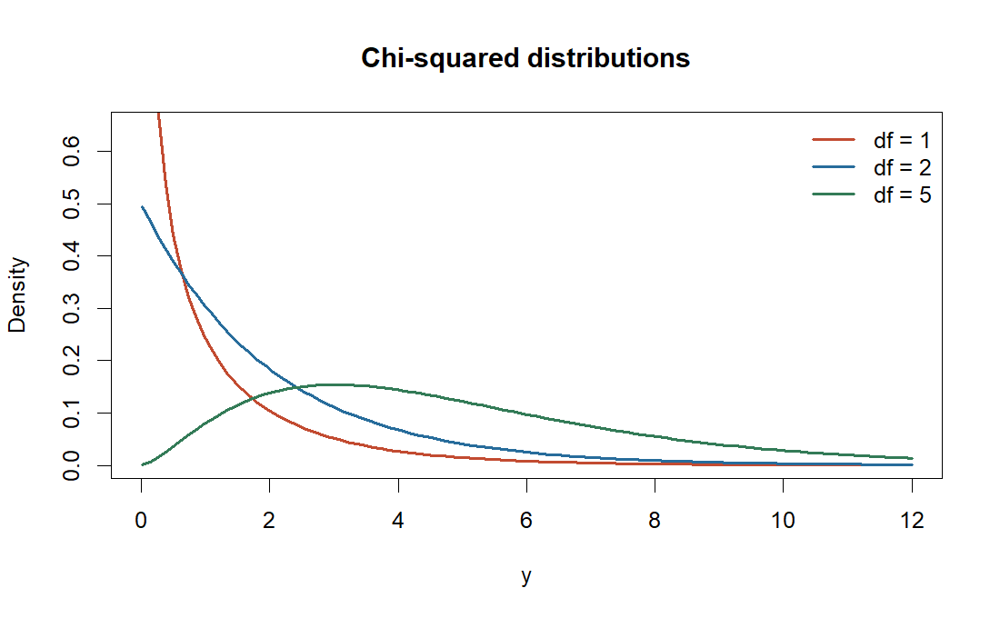
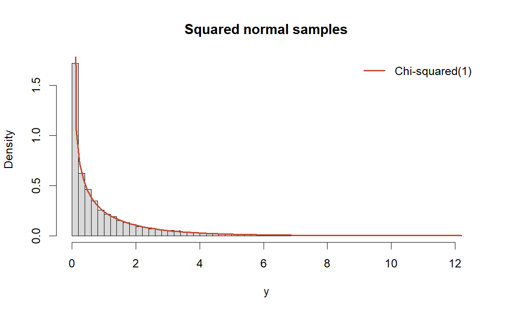
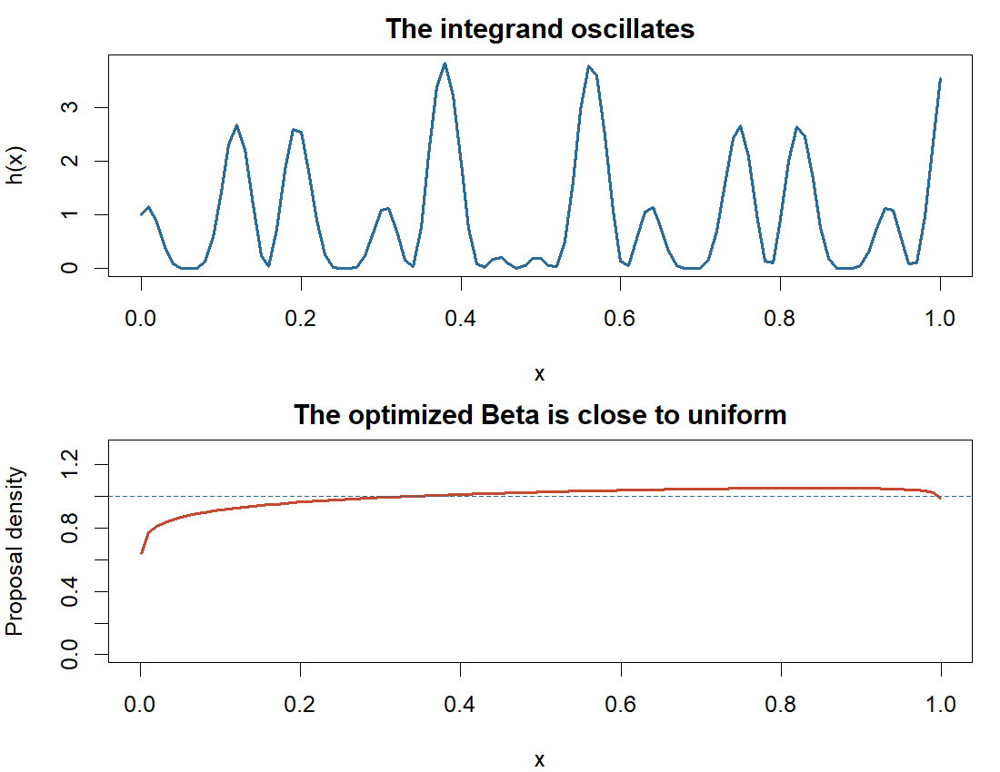
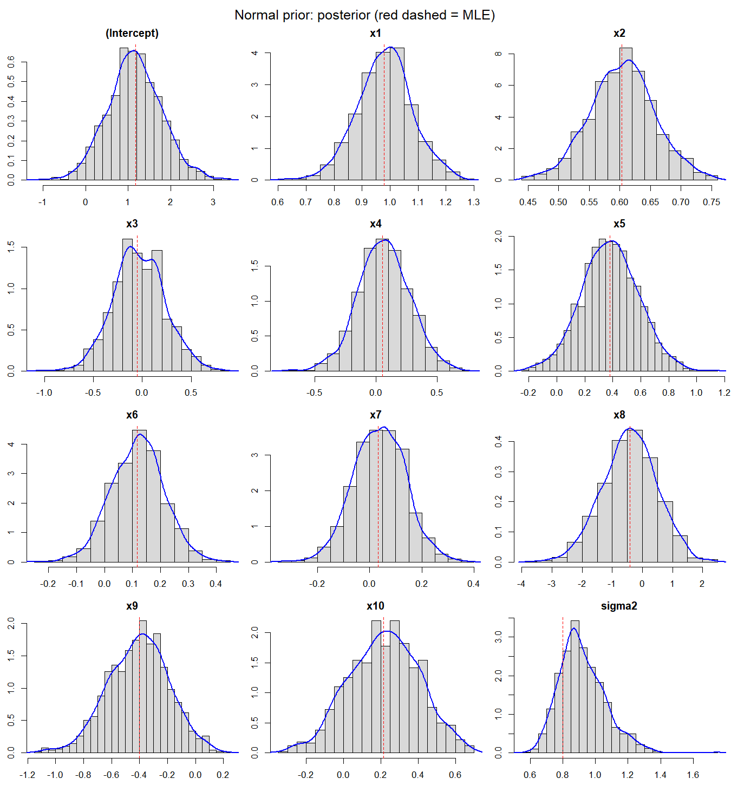
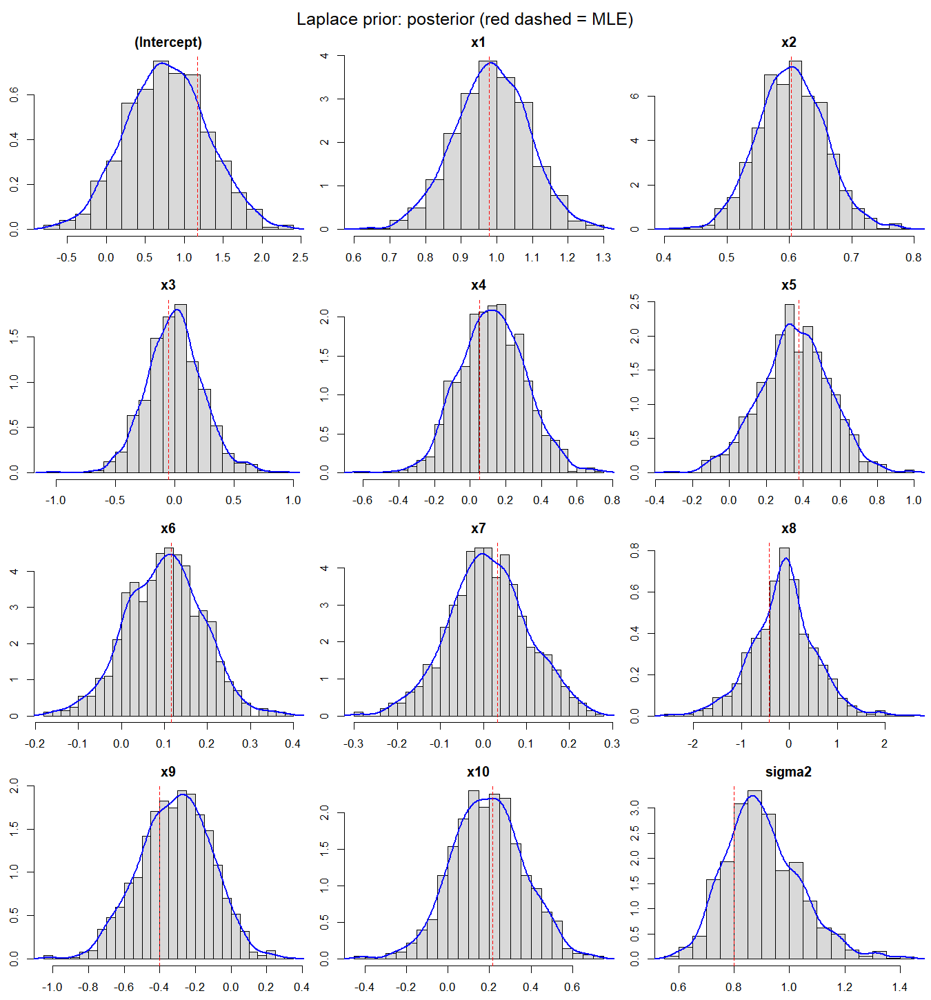
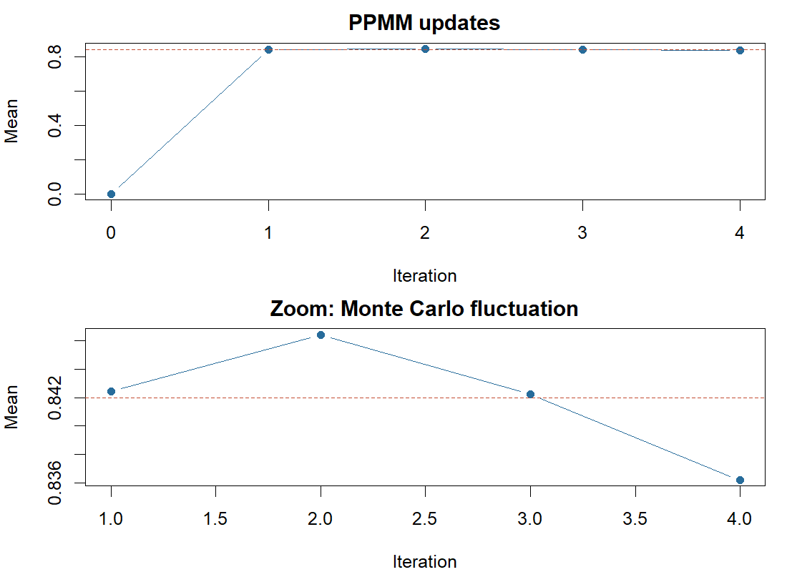

# 阅读说明 {#start}

这是一份**配合第一次作业的教学文档**，不是新的提交稿。它假设你理解基本概率逻辑、会看程序，但已经忘记很多分布公式和统计术语。每题都先放原题，再解释“它问什么、需要什么知识、怎样一步步推出答案”，最后对照现有 Rmd 解释代码、结果和英文说明。

原题来自新下载的 `Stat6011_hw1_question.pdf`；答案摘自当前 `STAT6011_HW1.Rmd`；进一步扩充了 `HW1学习讲解.md`。本手册没有修改这三个源文件。英文题目仅重新排版数学符号和换行；特别标出的原题符号问题保留并说明。计算结果与插图均由 R 运行现有答案或教学绘图代码得到。

**手机阅读：**推荐打开同名 HTML。正文、题目、公式、代码、图表都在一个文件内，不需要回到电脑查看附件。目录可以折叠，长公式和代码可以局部横向滑动；浏览器“查找”可定位 `Q2`、`q3-prior-sampler` 等。文件使用原生 MathML 显示公式，无需联网加载数学脚本。请使用较新的 Safari、Chrome 或 Edge；聊天软件内置预览若不显示公式，请选择“用浏览器打开”。

**建议分四次读：**先读基础与 Q1；再读 Q2；然后读 Q4；最后读较长的 Q3。Q3 中“补充 proposal 的推导与接受率估算”属于深入部分，第一遍可以先掌握原算法与困难，再回来读。

**当前答案的一个实质限制：**Q3 要求从 prior 提议并取得 1000 个 posterior 样本；这个算法在给定数据上极低效。答案实际保留了原算法各一百万次的失败记录，然后明确换用另一种 rejection proposal 得到同一 posterior 的样本。这一方法区别仍需向老师确认。手册解释它为什么数学上正确，也解释它为什么不能冒充完成了原题的算法限定。

# 0. 先恢复会反复用到的基础 {#basics}

## 0.1 随机变量、样本与参数

$X$ 表示尚未观测的随机变量，$x$ 表示它的一次实现。$X\sim N(\mu,\sigma^2)$ 的意思是“$X$ 服从均值为 $\mu$、方差为 $\sigma^2$ 的正态分布”。符号 $\sim$ 在这里不是“约等于”。

$i.i.d.$ 是 independent and identically distributed：各次随机变量相互独立，并服从同一分布。Q1、Q2 的模拟都使用独立抽样。$n$ 通常是样本量，但 Q2 的 $n=10000$ 是模拟次数，Q3 的 $n=100$ 是数据行数，不要把它们混为同一个对象。

参数与观测也要区分：Q3 的 $y$ 已经是手里的数据，$\beta,v$ 是未知参数；Bayesian inference 对未知参数建立分布。Q1 则没有在估计一个未知分布参数，而是在验证一个已知的分布变换。

## 0.2 连续分布：density 不是某一点的 probability

概率密度函数（PDF）$f_X(x)$ 满足

$$f_X(x)\geq0,\qquad \int_{-\infty}^{\infty}f_X(x)\,dx=1.$$

区间概率是曲线下面积：

$$P(a<X\leq b)=\int_a^b f_X(x)\,dx.$$

对于有密度的连续分布，$P(X=x)=0$；但 $f_X(x)$ 可以很大，甚至在某点附近趋于无穷。密度不需要小于 1。概率分布函数（CDF）则是

$$F_X(t)=P(X\leq t)=\int_{-\infty}^t f_X(x)\,dx.$$

因此 CDF 总在 0 与 1 之间，且单调不减。在通常的连续情形下 $F_X'(t)=f_X(t)$。Q1 中直方图比较 density，KS 检验比较 CDF。

## 0.3 期望、方差、标准差与标准误

对函数 $g$，

$$E[g(X)]=\int g(x)f_X(x)\,dx.$$

所以“积分”与“期望”只差一个你选择的 density。这正是 Q2 的出发点。

$$\operatorname{Var}(X)=E[(X-E[X])^2]=E[X^2]-E[X]^2.$$

标准差 SD 是方差的平方根。若 $Z_1,\ldots,Z_n$ 独立同分布、方差有限，则

$$E[\bar Z]=E[Z],\qquad
\operatorname{Var}(\bar Z)=\frac{\operatorname{Var}(Z)}{n}.$$

这里用到了独立性让协方差项为零，以及 $\operatorname{Var}(cZ)=c^2\operatorname{Var}(Z)$。平均值的标准差叫 standard error。Monte Carlo 中常用

$$\widehat{MCSE}=\frac{s_Z}{\sqrt n},\qquad
s_Z^2=\frac1{n-1}\sum_i(Z_i-\bar Z)^2.$$

**SD 描述单个样本值的分散，MCSE 描述平均值作为估计量的随机误差。** Q3 的 posterior SD 又描述参数的不确定性；多抽后验样本能降低均值计算的 MCSE，却不会减少数据本身留下的 posterior uncertainty。

## 0.4 三个容易混淆的统计概念

估计量 $\widehat\theta$ 的 bias 是 $E[\widehat\theta]-\theta$，variance 是不同重复实验中它的波动。均方误差分解为

$$E[(\widehat\theta-\theta)^2]
=\operatorname{Var}(\widehat\theta)+\operatorname{Bias}(\widehat\theta)^2.$$

“无偏”不等于“某一次计算特别准”。Q2 两种估计都是无偏的，所以优化理论精度可以最小化 variance，但不能保证优化后每个 seed 都更接近真实值。

大数定律告诉我们在相应条件下样本平均会接近期望；中心极限定理在有限方差等条件下进一步描述其误差大约是正态、大小为 $1/\sqrt n$。它们为 Monte Carlo 提供理由，而不是让有限样本误差消失。

## 0.5 R 的分布函数命名，先记这一组

| 前缀 | 含义 | 正态例子 | 卡方例子 |
|---|---|---|---|
| `d` | density：密度 | `dnorm(x)` | `dchisq(x, df=1)` |
| `p` | probability CDF：左侧累计概率 | `pnorm(x)` | `pchisq(x, df=1)` |
| `q` | quantile：CDF 的逆 | `qnorm(.975)` | `qchisq(.95, df=1)` |
| `r` | random：生成随机样本 | `rnorm(10000)` | `rchisq(10000, df=1)` |

`rnorm(10000)` 默认均值 0、标准差 1。`N(0,25)` 的第二参数是方差，但 R 应写 `rnorm(..., sd=5)`，不能写 `sd=25`。

# 1. Q1：正态平方为何是卡方 {#q1}

## 1.1 英文原题与任务拆解

> **Question 1**
>
> (a) Draw 10,000 random samples from the standard normal distribution $X\sim N(0,1)$. Let $Y=X^2$, and transform each sample to its square. Plot the histogram of $Y$ samples in conjunction with the density of $\chi^2_{(1)}$.
>
> (b) Test whether these square-transformed samples are from a chi-squared distribution with 1 degree of freedom, $\chi^2_{(1)}$.
>
> **[Total: 20 marks]**

(a) 要求的是**先生成正态，再逐个平方**，不是直接 `rchisq` 生成卡方。然后在同一张图里比较模拟样本与理论 density。(b) 要求统计检验，单凭“图像看起来差不多”不足以完成。

## 1.2 标准正态与卡方究竟是什么

正态分布的 PDF 为

$$f_X(x)=\frac1{\sqrt{2\pi\sigma^2}}
\exp\left[-\frac{(x-\mu)^2}{2\sigma^2}\right],\quad x\in\mathbb R.$$

标准正态取 $\mu=0,\sigma^2=1$。它的 PDF 常记作 $\phi(x)$，CDF 常记作 $\Phi(x)$。它对零对称，因此 $\Phi(-x)=1-\Phi(x)$。

如果 $Z_1,\ldots,Z_\nu$ 是**相互独立的标准正态变量**，则

$$V=Z_1^2+\cdots+Z_\nu^2\sim\chi^2_\nu.$$

这就是卡方分布的一种定义。自由度 $\nu$ 在这个构造中是独立标准正态平方项的数量。Q1 只有一个 $X^2$，所以 $\nu=1$。

为什么统计里到处有卡方？很多统计量是“标准化误差的平方和”。例如正态样本的 $\sum_i(X_i-\bar X)^2/\sigma^2$ 服从 $\chi^2_{n-1}$，在正态、独立等假设下成立；这里减去一个自由度，是因为使用样本均值后残差满足和为零的约束。本题没有估计后再减去均值，直接平方一个标准正态，所以就是 1 个自由度。

卡方 PDF 是

$$f_{\chi^2_\nu}(y)=
\frac{y^{\nu/2-1}e^{-y/2}}{2^{\nu/2}\Gamma(\nu/2)},\quad y>0.$$

其中 Gamma 函数定义为

$$\Gamma(a)=\int_0^\infty t^{a-1}e^{-t}dt,\quad a>0.$$

它满足 $\Gamma(k)=(k-1)!$（正整数 $k$），以及 $\Gamma(1/2)=\sqrt\pi$。它让归一化常数可以对非整数参数也有定义，不需要你记住数值积分实现。

因此 $\nu=1$ 时

$$f_Y(y)=\frac{e^{-y/2}}{\sqrt{2\pi y}},\quad y>0.$$

卡方的均值是 $\nu$，方差是 $2\nu$。所以 Q1 的 $Y$ 理论均值为 1、方差为 2；它不能取负值，并且右偏。$\nu=1$ 的密度在零附近很高，在无穷远逐渐下降。



## 1.3 不靠背定义：用 CDF 推一次

当 $y<0$ 时，平方不可能为负，因此 $F_Y(y)=0$。当 $y\geq0$ 时，

$$\begin{aligned}
F_Y(y)&=P(X^2\leq y)\\
&=P(-\sqrt y\leq X\leq\sqrt y)\\
&=\Phi(\sqrt y)-\Phi(-\sqrt y)\\
&=2\Phi(\sqrt y)-1.
\end{aligned}$$

再对 $y>0$ 求导，链式法则给出

$$\begin{aligned}
f_Y(y)&=2\phi(\sqrt y)\frac1{2\sqrt y}\\
&=\frac{e^{-y/2}}{\sqrt{2\pi y}}.
\end{aligned}$$

这正是 $\chi^2_1$ 的密度。变换 $X\mapsto X^2$ 是多对一的，正负两个根都贡献概率；用 CDF 方法就不容易漏掉一半。

## 1.4 (a) 现有答案：代码与图

以下是 Rmd 的 `q1-sim` 原代码：

**Rmd 代码块：`q1-sim`**

```r
set.seed(6011)
x <- rnorm(10000)
y <- x^2
hist(y, breaks = 70, probability = TRUE, col = "grey85",
     main = "Squared standard normal samples", xlab = "y")
curve(dchisq(x, df = 1), from = 0.001, to = max(y),
      add = TRUE, col = "red", lwd = 2)
legend("topright", "Chi-squared(1)", col = "red", lwd = 2, bty = "n")
```

- `set.seed(6011)` 固定随机数生成状态，便于重复结果，不改变理论分布。
- `x` 是长度 10000 的向量；`x^2` 是逐元素平方，不是矩阵乘法。
- `hist(..., probability=TRUE)` 把柱子画成密度。一个柱子的高度是“该区间比例 / 区间宽度”，总面积约为 1，才能与理论密度比较。
- `breaks=70` 是期望分箱数，R 会选择便于标记的断点，不保证恰好 70 箱。
- `curve` 中的 `x` 是绘图时变化的横坐标，不是再次使用模拟向量中的每个元素。`dchisq(x,df=1)` 计算这些横坐标处的理论密度。
- `from=.001` 避免直接在零点计算无穷密度；`add=TRUE` 叠到已有图上，`lwd=2` 加粗线条。
- `legend` 给理论曲线添加标签，`bty="n"` 不画图例边框。



答案英文说：

> “The histogram agrees with the chi-squared density. Its density is unbounded at zero, so the first histogram bar need not reach the density curve.”

意思是形状整体相符，但零附近理论 density 趋于无穷，有限宽度的第一根柱子表示平均密度，不必贴着曲线最高处。它解释图中的正常差异，不是为了忽略不匹配。

## 1.5 (b) KS 检验如何工作

定义样本的经验 CDF：

$$F_n(t)=\frac1n\sum_{i=1}^n\mathbf1\{Y_i\leq t\}.$$

$\mathbf1\{A\}$ 是 indicator：事件 $A$ 发生取 1，否则取 0。所以 $F_n(t)$ 就是样本中不大于 $t$ 的比例。

单样本 Kolmogorov–Smirnov 检验计算

$$D_n=\sup_t|F_n(t)-F_0(t)|,$$

其中 $F_0$ 是 $\chi^2_1$ CDF，$\sup$ 表示取所有 $t$ 上的最大差距。差距越大，对 $H_0:Y\sim\chi^2_1$ 越不利。备择假设是分布不等于这个 CDF，不只是均值不同。

**Rmd 代码块：`q1-test`**

```r
ks <- ks.test(y, "pchisq", df = 1)
ks
```

`"pchisq"` 指定理论 CDF；这里不能填密度函数 `"dchisq"`。`df=1` 传给这个 CDF。检验对象的分布没有用样本去拟合未知参数，所以可以按完全指定的连续分布使用普通 KS 检验。

p 值的定义是：假定 $H_0$ 成立，重新抽一组同样大小的样本，得到至少与当前差距一样大的概率，即 $P_{H_0}(D_n^{rep}\geq D_n^{obs})$。这里 rep 表示重复抽样、obs 表示当前观测。显著性水平 0.05 是事先选定的拒绝阈值：p 值小于它时拒绝 $H_0$；在原假设成立时，它控制检验长期误拒绝的概率（近似检验会有近似误差）。

本次 $D\approx0.00587$，p 值约 **0.8809**。在 5% 显著性水平下不拒绝 $H_0$。当前 R 输出采用 asymptotic p-value，它是检验近似计算的描述，不是“数据渐近才是卡方”的意思。

原答案接着说：

> “This is a distributional check, not a proof.”

统计检验不是数学证明。不拒绝表示当前样本没有提供足够证据反对 $H_0$；**不是**“$H_0$ 为真的概率为 88%”。数学关系已经由上面的 CDF 推导证明，检验主要是在有限随机样本上做检查。

**自测：**如果改用 `rnorm(10000, sd=2)` 再平方，能否仍与 $\chi^2_1$ 直接比较？答案：不能；$X/2$ 才是标准正态，所以 $X^2/4\sim\chi^2_1$。

# 2. Q2：积分、重要性采样与数值求积 {#q2}

## 2.1 英文原题

> **Question 2**
>
> (a) To compute $\int_0^1h(x)dx$, where
> $$h(x)=[\cos(50x)+\sin(20x)]^2,$$
> generate $u_1,\ldots,u_n$ ($n=10,000$) i.i.d. Unif$(0,1)$ random variables, and approximate
> $$\int_0^1h(x)dx=\int_0^1h(x)\cdot1dx\quad\text{with}\quad\sum_{i=1}^nh(u_i)/n.$$
>
> (b) It is clear that any $X\sim\operatorname{Beta}(\alpha,\beta)$ density function $f(x)$ can be used to simulate $u_1,\ldots,u_n$ ($n=10,000$), because
> $$\int_0^1h(x)dx=\int_0^1\frac{h(x)}{f(x)}f(x)dx.$$
> Find the optimal values of Beta distribution $\alpha$ and $\beta$ to achieve the highest efficiency for the Monte Carlo approximation (i.e., with $n=10,000$ the approximation would be the most accurate).
>
> (c) Use Gaussian quadrature to compute the integral $\int_0^1h(x)dx$, which is treated as the benchmark for comparison.
>
> **[Total: 30 marks]**

三问都在求**同一个确定的数** $I$，区别在计算方法：(a) 均匀随机取点；(b) 更聪明地随机取点并纠偏；(c) 用确定的节点与权重算高精度参考值。

## 2.2 (a) 把面积改写成期望

$U\sim\operatorname{Unif}(a,b)$ 的 density 在区间内是 $1/(b-a)$，区间外为零。因为这里 $a=0,b=1$，密度恰好是 1：

$$E[h(U)]=\int_0^1h(u)\cdot1\,du=I.$$

所以可以用 $\widehat I_U=n^{-1}\sum_i h(U_i)$。若区间是一般的 $[a,b]$，应乘上长度 $b-a$，否则只估计了区间上的平均高度。

无偏性来自

$$E[\widehat I_U]=\frac1n\sum_iE[h(U_i)]=I.$$

独立性则给出 $\operatorname{Var}(\widehat I_U)=\operatorname{Var}(h(U))/n$。本题 $0\leq h(x)\leq4$，所以 uniform 方法的方差有限。

**Rmd 代码块：`q2-uniform`**

```r
h <- function(x) (cos(50*x) + sin(20*x))^2
set.seed(6012)
n <- 10000
u <- runif(n)
mc <- mean(h(u))
mc.se <- sd(h(u))/sqrt(n)
c(estimate = mc, MCSE = mc.se)
```

`function(x)` 定义函数，`cos` 与 `sin` 使用弧度。`runif(n)` 默认区间为 $(0,1)$。`h(u)` 一次算出全部 $n$ 个函数值。`mean` 就是取平均，`sd(...)/sqrt(n)` 给出 MCSE；`c(estimate=...,MCSE=...)` 只是把结果命名后一起显示。

本次估计为 **0.959393**，MCSE 约 **0.010482**。其含义是：若重复整套 10000 次采样，估计值的标准差约为 0.0105。它不是“本次绝对误差一定小于 0.0105”。

## 2.3 Beta 分布从哪里来

Beta$(\alpha,\beta)$ 定义在 $(0,1)$，参数 $\alpha,\beta>0$。密度是

$$f_{\alpha,\beta}(x)=\frac{x^{\alpha-1}(1-x)^{\beta-1}}{B(\alpha,\beta)},$$

$$B(\alpha,\beta)=\int_0^1x^{\alpha-1}(1-x)^{\beta-1}dx
=\frac{\Gamma(\alpha)\Gamma(\beta)}{\Gamma(\alpha+\beta)}.$$

$B$ 是归一化常数，使面积为 1。均值和方差分别为

$$E[X]=\frac\alpha{\alpha+\beta},\qquad
\operatorname{Var}(X)=\frac{\alpha\beta}{(\alpha+\beta)^2(\alpha+\beta+1)}.$$

两参数都为 1 时密度就是 1，即 Uniform$(0,1)$；两者相等且大于 1 时通常向中间集中；小于 1 时可向端点集中。它提供一族形状灵活、容易抽样的分布，但只有两个参数，并不能表示任意多峰函数。

## 2.4 (b) 改变取点分布后为什么要除以 $f$

如果 $U$ 从 Beta 抽样，直接平均 $h(U)$ 得到的期望是 $\int h(x)f(x)dx$，已经不是原来的积分。要抵消采样频率的改变：

$$E_f\left[\frac{h(U)}{f(U)}\right]
=\int_0^1\frac{h(x)}{f(x)}f(x)dx=I.$$

这是 importance sampling。Beta density 在 $(0,1)$ 正值，覆盖了积分区域；端点是零测集，不影响这里的积分等式。

记 $Z=h(U)/f(U)$。先算二阶矩：

$$E_f[Z^2]=\int_0^1\frac{h(x)^2}{f(x)^2}f(x)dx
=\int_0^1\frac{h(x)^2}{f(x)}dx.$$

因此

$$\operatorname{Var}(\widehat I_f)
=\frac1n\left[\int_0^1\frac{h(x)^2}{f(x)}dx-I^2\right].$$

这个推导解释了为什么目标函数里是 $h^2/f$，不是 $h/f$ 或 $h^2/f^2$。虽然 $h$ 本来就有平方，算二阶矩仍需要再平方。

$I^2$ 与 $\alpha,\beta$ 无关，$n$ 固定，所以最优参数求解为

$$\min_{\alpha,\beta}\ J(\alpha,\beta),\qquad
J=\int_0^1\frac{h(x)^2}{f_{\alpha,\beta}(x)}dx.$$

这是在优化重复抽样意义下的精度；不是试很多 seed 挑一次好运。因为估计无偏，最小方差也等价于最小均方误差。

## 2.5 哪些 Beta 参数会导致无限方差

仅能写出期望恒等式，不表示估计量方差一定有限。靠近零时，$h(0)=1$，所以

$$\frac{h(x)^2}{f(x)}\ \text{像常数乘}\ x^{1-\alpha}.$$

而 $\int_0^\epsilon x^r dx$ 在且仅在 $r>-1$ 时有限，于是需要 $\alpha<2$。另一端因为 $h(1)\ne0$，同理需要 $\beta<2$。结合 Beta 本身的参数范围，得到

$$0<\alpha<2,\qquad0<\beta<2.$$

代码用 0.01 与 1.99 作为数值边界，避免直接碰到边界。最优结果离边界很远；极靠近 2 的数值积分会困难，所以不要把一次优化警告直接理解成数学发散，也不要忽略真正的无限方差参数。

## 2.6 对照优化与 importance sampling 代码

**Rmd 代码块：`q2-optimize`**

```r
second.moment <- function(ab) {
  integrate(function(x) h(x)^2/dbeta(x, ab[1], ab[2]),
            0, 1, subdivisions = 1000, rel.tol = 1e-8)$value
}
opt <- optim(c(1, 1), second.moment, method = "L-BFGS-B",
             lower = c(.01, .01), upper = c(1.99, 1.99))
ab <- opt$par
names(ab) <- c("alpha", "beta")
ab
set.seed(6013)
u.beta <- rbeta(n, ab[1], ab[2])
z <- h(u.beta)/dbeta(u.beta, ab[1], ab[2])
is <- mean(z)
is.se <- sd(z)/sqrt(n)
c(estimate = is, MCSE = is.se)
```

逐段看：

1. `ab` 是长度为 2 的参数向量。`ab[1]` 是 $\alpha$，`ab[2]` 是 $\beta$；R 从 1 开始索引。
2. `dbeta(x,...)` 是对应密度，`integrate` 数值计算 $J$。`$value` 取积分结果；`subdivisions` 限制积分细分次数，`rel.tol` 是要求的相对精度。
3. `optim(c(1,1),...)` 从 uniform 开始搜索；`L-BFGS-B` 是支持参数上下界的数值优化方法，不是另一种采样方法。
4. `opt$par` 返回找到的参数，不是最小目标函数值；后者在 `opt$value`。
5. `rbeta` 生成 10000 个 Beta 点。`z` 是重新加权后的函数值；其平均与标准误才是这次要报告的估计。

原答案说：

> “This minimizes variance within the Beta family; it does not guarantee the smallest realized error on every run.”

即结果只是在 Beta 家族内优化理论方差，不能保证每次随机结果都更准。数值解约为 **$(1.0780,1.0145)$**，本次估计 **0.966576**，MCSE **0.010427**。

如果不限制分布家族，且 $h\geq0$，理想 proposal 是 $f^*(x)=h(x)/I$。这时被抽到的点满足 $h(U)/f^*(U)=I$，估计量成为常数，方差为零。但它的归一化常数就是想求的 $I$，一般不能直接用来免费解决问题。这里用它帮助理解：应更多在对积分有贡献的区域取点。



## 2.7 (c) Gaussian quadrature 不是从 Gaussian 抽样

这里 Gaussian 指一类求积方法。它选择节点 $t_k$ 与权重 $w_k$，使

$$\int_{-1}^1g(t)dt\approx\sum_{k=1}^m w_kg(t_k)$$

对所有次数不超过 $2m-1$ 的多项式都精确成立。一般平滑函数可以由多项式近似，所以它可能非常准确。我们的三角函数不是有限次多项式，不能因此宣称 64 个节点在数学上完全精确，仍应做节点数比较。

区间是有限的、积分权重为 1，所以用 Gauss–Legendre。Gauss–Hermite 的标准形式对应 $\int_{-\infty}^{\infty}e^{-t^2}g(t)dt$，不能仅因为名字里有 Gaussian 就用于当前题。

要把 $[0,1]$ 变为 $[-1,1]$，设 $t=2x-1$，则 $x=(t+1)/2$、$dx=dt/2$：
$$I=\frac12\int_{-1}^1h((t+1)/2)dt
\approx\frac12\sum_{k=1}^m w_kh((t_k+1)/2).$$

外面的 $1/2$ 是变量代换的 Jacobian，不能忘。

**Rmd 代码块：`q2-quadrature`**

```r
gauss.int <- function(m) {
  g <- statmod::gauss.quad(m, kind = "legendre")
  sum(g$weights*h((g$nodes + 1)/2))/2
}
benchmark <- gauss.int(128)
c(nodes64 = gauss.int(64), nodes128 = benchmark)
comparison <- data.frame(
  method = c("Uniform MC", "Beta importance sampling", "Gauss-Legendre"),
  estimate = c(mc, is, benchmark),
  MCSE = c(mc.se, is.se, NA))
comparison$absolute.error <- abs(comparison$estimate - benchmark)
knitr::kable(longtable = FALSE, comparison, digits = 7)
var.uniform <- second.moment(c(1, 1)) - benchmark^2
var.beta <- second.moment(ab) - benchmark^2
c(variance.ratio = var.beta/var.uniform,
  variance.reduction = 1 - var.beta/var.uniform)
```

`statmod::gauss.quad` 用 `包名::函数名` 直接调用函数，不必先 `library`。`g$nodes` 与 `g$weights` 是确定性节点和权重；`sum(...)` 实现上面的公式。`NA` 表示“不适用/缺失”，因为这里没有 Gaussian quadrature 的 Monte Carlo 抽样误差，不是说数值求积误差绝对为零。

`second.moment(c(1,1))-benchmark^2` 算 uniform 下单个函数值的方差；最优 Beta 同理。两者再除以相同 $n$ 才是估计量方差，但求比值时 $n$ 抵消，所以不必重复除。

|method                   | estimate|     MCSE| absolute.error|
|:------------------------|--------:|--------:|--------------:|
|Uniform MC               |  0.95939| 0.010482|      0.0058079|
|Beta importance sampling |  0.96658| 0.010427|      0.0013752|
|Gauss-Legendre           |  0.96520|       NA|      0.0000000|

原答案的 “the two quadrature results agree to the displayed precision” 指 64 与 128 节点结果在所显示精度上相同，benchmark 约 **0.9652**。最优 Beta 的 variance ratio 约 **0.99308**，减少 **0.69%**。这是很小的改进，原因是 Beta 无法追踪许多峰谷，不应该把单次误差缩小幅度当成理论效率提升。

**自测：**若把 MC 样本量从 10000 提高到 40000，预计 MCSE 变成多少倍？答案：约为原来的一半。若忘掉 Beta 密度分母，估计目标是什么？答案：$E_{Beta}[h(U)]$，而不是 $I$。

# 3. Q3：贝叶斯线性回归与后验采样 {#q3}

## 3.1 英文原题

> **Question 3**
>
> (a) Fit a linear model to the data in Q3.csv,
> $$y=\beta^\top X+\epsilon,$$
> where $\beta=(\beta_0,\ldots,\beta_{10})^\top$ is a vector of regression coefficients and the error $\epsilon\sim N(0,\sigma^2)$. We assign each $\beta_j$ ($j=1,\ldots,11$) a normal $N(0,5^2)$ prior and $\sigma^2$ an inverse-gamma$(0.1,0.1)$ prior.
>
> Apply rejection sampling to draw posterior samples. Let $\theta=(\beta,\sigma^2)$. Using the prior $\pi(\theta)$ as the candidate, compute
> $$C^*=\sup_{\theta\in\Theta}\frac{\pi(\theta\mid y)}{\pi(\theta)}
> \propto\sup_{\theta\in\Theta}f(y\mid\theta)=f(y\mid\widehat\theta),$$
> where $\widehat\theta$ is the MLE.
>
> Implement the rejection sampling as follows:
>
> • Simulate $u\sim\operatorname{Unif}[0,1]$,
>
> • Simulate $\theta\sim\pi(\theta)$,
>
> • Accept $\theta$ if
> $$u\leq\frac{\pi(\theta\mid y)}{C^*\pi(\theta)}
> =\frac{f(y\mid\theta)}{f(y\mid\widehat\theta)}.$$
>
> Draw 1000 posterior samples of $\beta,\sigma^2$, plot the histograms and densities, and compute the posterior means and variances. Compare them with the MLEs.
>
> (b) Change the prior of each $\beta_j$ ($j=1,\ldots,11$) to be Laplace$(0,1)$ with density
> $$f(\beta)=\frac12\exp(-|\beta|),$$
> and repeat the computation. Which prior is more efficient (i.e., with fewer rejections)?
>
> (c) Some of the true values of $\beta$ are zero (sparsity), which should be shrunk to zero. The normal prior on $\beta$ can be viewed as ridge regression. Fit a ridge regression model and compare the results. The Laplace prior on $\beta$ can be viewed as Lasso regression. Fit a Lasso regression model and compare the results.
>
> **[Total: 30 marks]**

原题的系数向量从 0 编号到 10，后文却写 $j=1,\ldots,11$。现有答案将其解释为**全部 11 个系数，包括截距**都有同样的独立 prior，而不是多出第 12 个系数。我们用 $v=\sigma^2$ 简化记号。

## 3.2 把单个观测的模型写成矩阵

对第 $i$ 行数据，

$$y_i=\beta_0+\beta_1x_{i1}+\cdots+\beta_{10}x_{i,10}+\epsilon_i.$$

$\beta_0$ 是截距，对应特征恒为 1。把所有观测竖着放在一起：

$$y=X\beta+\epsilon,\qquad \epsilon\sim N_n(0,vI_n).$$

这时 $y$ 是 $n\times1$，$X$ 是 $n\times p$，$\beta$ 是 $p\times1$，本题 $n=100,p=11$。这里的矩阵 $X$ 与原题单观测的特征向量记号相同但形状不同。$I_n$ 是单位矩阵，表示不同观测误差独立且方差相同。

线性模型假设的是对参数线性，而不一定要求原始物理规律是线性的；但这道题直接使用给定的十列特征，没有添加非线性特征。

## 3.3 先分清 likelihood、prior、posterior

**Likelihood（似然）**回答：若参数是 $\theta$，已经看到这份数据的相对支持程度是多少？在本题中各行独立，正态密度相乘：

$$L(\beta,v)=p(y\mid\beta,v)
=(2\pi v)^{-n/2}\exp\left[-\frac{\|y-X\beta\|^2}{2v}\right].$$

$\|r\|^2=r^\top r=\sum_i r_i^2$；残差平方和记作 RSS。将 $y$ 固定后，likelihood 是参数的函数，它不需要对参数积分为 1。

**Prior（先验）**$\pi(\beta,v)$ 描述看到数据前对参数的分布假设。题目中解释为系数之间、以及系数与 $v$ 之间独立，所以

$$\pi(\beta,v)=\left[\prod_{j=0}^{10}\pi(\beta_j)\right]\pi(v).$$

**Posterior（后验）**由 Bayes 公式给出：

$$p(\beta,v\mid y)=\frac{L(\beta,v)\pi(\beta,v)}{p(y)},$$

$$p(y)=\int L(\beta,v)\pi(\beta,v)\,d\beta\,dv.$$

$p(y)$ 是 evidence/边际似然；对参数而言它是常数，使 posterior 总面积为 1。写 $p(\theta\mid y)\propto L(\theta)\pi(\theta)$ 时，只是省略了这个归一化常数，不是省略 prior。

**Proposal（提议分布）**则是计算工具：程序先从哪里产生候选点。它可以等于 prior，也可以不等于。改变 prior 会改变统计模型；在正确修正接受概率时，改变 proposal 可以只改变效率而不改变目标 posterior。这是理解本题困难的关键。

## 3.4 本题的三种 prior 分布

### Normal prior

$\beta_j\sim N(0,25)$ 的密度为

$$\pi(\beta_j)=\frac1{5\sqrt{2\pi}}\exp(-\beta_j^2/50).$$

它认为系数更可能靠近零，但标准差 5 相对本数据中的多数系数很宽。负 log density 里与系数有关的是 $\beta_j^2/50$，这就是后面 L2 penalty 的来源。

### Gamma 与 inverse-gamma prior

本手册用 **shape–rate** 参数化 Gamma：

$$G\sim\operatorname{Gamma}(a,b),\quad
f_G(g)=\frac{b^a}{\Gamma(a)}g^{a-1}e^{-bg},\quad g>0.$$

均值 $a/b$、方差 $a/b^2$。如果改用 scale $s$，则 $s=1/b$；R 的 `rate` 与 `scale` 不能互换使用同一个数。

令 $V=1/G$。变量变换的 Jacobian 是 $|d(1/v)/dv|=v^{-2}$，于是

$$f_V(v)=\frac{b^a}{\Gamma(a)}v^{-a-1}e^{-b/v},\quad v>0.$$

这就是我们使用的 inverse-gamma$(a,b)$。因此题目 $IG(0.1,0.1)$ 可以用 `1/rgamma(..., shape=.1, rate=.1)` 抽样。它支持正数，适合方差这样的参数。$IG(a,b)$ 的均值只在 $a>1$ 时存在，方差只在 $a>2$ 时存在；所以本题 prior 本身没有有限均值，不应把它想成“集中在 0.1 左右的方差”。posterior 则受到数据约束，可以有有限均值和方差。

### Laplace prior

一般 Laplace$(\mu,b)$ 密度为

$$f(x)=\frac1{2b}\exp\left(-\frac{|x-\mu|}{b}\right),\quad b>0.$$

它均值为 $\mu$、方差为 $2b^2$，中心有尖角。题目是 $\mu=0,b=1$，所以负 log density 中与系数有关的项为 $|\beta_j|$。

若 $E\sim\operatorname{Exp}(1)$，随机符号 $S$ 独立取 $+1/-1$ 各一半，则 $SE\sim\operatorname{Laplace}(0,1)$。这解释代码中的 `rexp(...) * sample(c(-1,1), ..., TRUE)`。`rexp` 默认 rate 为 1。

## 3.5 先求 MLE：为什么等价于最小二乘

取自然对数：

$$\ell(\beta,v)=-\frac n2\log(2\pi v)-\frac{\operatorname{RSS}(\beta)}{2v}.$$

固定 $v>0$ 时，最大化 $\ell$ 等价于最小化 RSS。对 $\beta$ 求导：

$$\nabla_\beta\operatorname{RSS}=-2X^\top(y-X\beta).$$

令其为零，得到 normal equations $X^\top X\widehat\beta=X^\top y$。当 $X$ 满列秩时，

$$\widehat\beta=(X^\top X)^{-1}X^\top y.$$

再令 $S=\operatorname{RSS}(\widehat\beta)$。对 $v$ 求导：

$$\frac{\partial\ell}{\partial v}=-\frac n{2v}+\frac S{2v^2}=0
\quad\Longrightarrow\quad\widehat v=S/n.$$

因此 variance MLE 除以 $n$；回归软件报告的无偏误差方差估计常除以 $n-p$，两者目的不同。

**Rmd 代码块：`q3-mle`**

```r
d <- read.csv("Q3.csv", row.names = 1)
fit <- lm(y ~ ., data = d)
X <- model.matrix(fit)
y3 <- d$y
n3 <- nrow(X)
p <- ncol(X)
bhat <- coef(fit)
A <- crossprod(X)
S <- sum(resid(fit)^2)
vhat <- S/n3
log.Lmax <- -n3/2*(log(2*pi*vhat) + 1)
c(sigma2.MLE = vhat, log.Lmax = log.Lmax)
```

- `row.names=1` 把 CSV 的第一列作为行号，防止将索引当作预测变量。
- `lm(y ~ ., data=d)` 表示用其他所有变量解释 `y`，默认含截距；内部并不是简单粗暴直接求逆。
- `model.matrix(fit)` 给出设计矩阵，`coef(fit)` 提取系数估计，`resid(fit)` 提取残差。
- `crossprod(X)` 等于 $X^\top X$；`crossprod(X,y3)` 则等于 $X^\top y$。
- `log.Lmax` 是最大 log likelihood，代入 $\widehat v$ 后 $S/(2\widehat v)=n/2$，于是有代码里的简式。

本次 $\widehat v\approx0.800401$，$\log L_{\max}\approx-130.7617$。likelihood 的数值很小是连续密度乘积的正常现象，不是模型“几乎没有概率正确”。

## 3.6 Rejection sampling 为什么能产生目标分布

先讲一般形式。想从 density $f(\theta)$ 抽样，但只能方便地从 $q(\theta)$ 抽样。找到常数 $C$，使所有参数点上都有

$$f(\theta)\leq Cq(\theta).$$

抽 $\theta\sim q$、$U\sim\operatorname{Unif}(0,1)$，当 $U\leq f(\theta)/(Cq(\theta))$ 时保留。一个位置“被提议且被保留”的 density 是

$$q(\theta)\frac{f(\theta)}{Cq(\theta)}=f(\theta)/C.$$

归一化后正好是 $f$。接受概率的平均值为 $1/C$（这里 $f,q$ 都归一化）。所以 envelope 太松会浪费，但 envelope 若不够高则算法不正确。

本题 $q(\theta)=\pi(\theta)$，目标 $f(\theta)=L(\theta)\pi(\theta)/p(y)$。因此

$$C^*=\frac{L_{\max}}{p(y)},\qquad
a(\theta)=\frac{L(\theta)}{L_{\max}}.$$

真正的归一化 $C^*$ 包含 $p(y)$，不过它在接受概率里约掉了。原题的 $\propto$ 正是在省略这个证据常数。

## 3.7 推出代码使用的 log 接受概率

令 $\delta=\beta-\widehat\beta$、$A=X^\top X$。由于最小二乘残差满足 $X^\top(y-X\widehat\beta)=0$，展开后交叉项消失：

$$\operatorname{RSS}(\beta)=S+\delta^\top A\delta.$$

所以

$$\begin{aligned}
\log a(\beta,v)
&=\ell(\beta,v)-\ell(\widehat\beta,\widehat v)\\
&=\frac n2\left[\log(\widehat v/v)+1\right]
-\frac{S+\delta^\top A\delta}{2v}.
\end{aligned}$$

因为 $\log$ 单调递增，$U\leq a$ 等价于 $\log U\leq\log a$。用 log 是为了避免把极小的 likelihood 先算成浮点数零；**它不会提升真实接受率**。

## 3.8 现有答案的 prior-proposal 代码精读

**Rmd 代码块：`q3-prior-sampler`**

```r
prior.reject <- function(prior, target = 1000, max.proposals = 1000000) {
  samples <- matrix(numeric(0), ncol = p + 1)
  tried <- 0
  while (nrow(samples) < target && tried < max.proposals) {
    m <- min(10000, max.proposals - tried)
    b <- if (prior == "normal") {
      matrix(rnorm(m*p, sd = 5), nrow = m)
    } else {
      matrix(rexp(m*p)*sample(c(-1, 1), m*p, TRUE), nrow = m)
    }
    v <- 1/rgamma(m, shape = .1, rate = .1)
    delta <- sweep(b, 2, bhat)
    rss <- S + rowSums((delta %*% A)*delta)
    log.a <- n3/2*(log(vhat/v) + 1) - rss/(2*v)
    ok <- which(log(runif(m)) <= log.a)
    need <- target - nrow(samples)
    if (length(ok) >= need) {
      tried <- tried + ok[need]
      samples <- rbind(samples, cbind(b, v)[ok[seq_len(need)], , drop = FALSE])
    } else {
      tried <- tried + m
      samples <- rbind(samples, cbind(b, v)[ok, , drop = FALSE])
    }
  }
  list(samples = samples, proposed = tried)
}
set.seed(6014)
normal.pilot <- prior.reject("normal")
laplace.pilot <- prior.reject("laplace")
knitr::kable(longtable = FALSE, data.frame(
  prior = c("Normal", "Laplace"),
  proposals = c(normal.pilot$proposed, laplace.pilot$proposed),
  accepted = c(nrow(normal.pilot$samples), nrow(laplace.pilot$samples))))
```

这段代码看起来较长，但可以分成六件事。

**① 保存容器与停止条件。** `samples` 一开始有 0 行、$p+1=12$ 列：11 个系数加一个方差。`tried` 是已经提议的点数。`while` 要求“还没拿够 target，并且还没超过尝试上限”，`&&` 是逻辑“且”。一百万次上限用于避免无限等待，不是说原题只要求一百万次。

**② 分批生成候选。** 每批最多 10000 个。`b` 是 $m\times p$，每行是一整套系数。Normal 分支生成 $mp$ 个独立 $N(0,25)$；Laplace 分支生成随机符号乘指数。`v` 是长度 $m$ 的独立方差候选。

**③ 向量化计算 RSS。** `sweep(b,2,bhat)` 表示按列减去各自 MLE，得到每行的 $\delta$。`delta %*% A` 是矩阵乘法；再与 `delta` 逐元素相乘、用 `rowSums` 求每行和，就得到各行的 $\delta^\top A\delta$。`*` 是逐元素乘，`%*%` 是矩阵乘，含义不同。

**④ 接受或拒绝。** `log.a` 一次算每个候选的 log 接受概率。`which(...)` 返回通过判断的行号，保存在 `ok`。

**⑤ 只保留需要的前几个。** `need` 是还差多少样本。如果某批接受点已足够，只取 `ok[seq_len(need)]`。`ok[need]` 是拿到最后一个所需样本时的提议位置。程序虽然向量化预生成了整批，`tried` 报告的是顺序算法到获得第 1000 个接受点为止的有效提议数，不是所有预生成随机数的数量。

**⑥ 组合并返回。** `cbind(b,v)` 按列合并系数与方差；`rbind` 把新行追加到已有样本。`drop=FALSE` 防止只剩一行时 R 自动把矩阵降成向量。最后返回一个有 `samples` 与 `proposed` 字段的 list，外部用 `$` 读取。

这次两种 prior 各一百万次，实际接受数都为 **0**。原答案写：

> “Neither prior produced 1000 posterior samples in this run. I therefore cannot report 1000 draws from the requested prior-proposal algorithm.”

这是对未完成部分的真实说明；不能把未获得样本说成“posterior variance 为零”。没有样本就无法直接用这次 pilot 估计 posterior moments。

## 3.9 为什么在 12 维参数空间这么困难

正常的 posterior 会集中在数据支持的区域；但宽 prior 仍在巨大参数空间分散提议。每个系数单看“有机会接近正确值”，不表示 11 个系数与噪声方差能同时合适。较差的拟合又会通过指数 likelihood 被强烈压低。

当前估算的 prior-proposal 接受率是：

| 系数 prior | 原算法接受率估计 | 取得 1000 点的期望提议数 |
|---|---:|---:|
| Normal$(0,25)$ | $5.07\times10^{-19}$ | $1.97\times10^{21}$ |
| Laplace$(0,1)$ | $2.86\times10^{-12}$ | $3.50\times10^{14}$ |

它们不是由“0/1000000”算出来的；那个比值只给出这次观察到的零接受率，无法支持这样精细的比较。上表来自后文的另一种积分估算。**对题设原算法，Laplace 更高效；但两者都远远不适合直接跑到 1000 个接受点。**

不能为了交作业，把候选 likelihood 的样本最大值当作真正上界、把接受比值乘一个随意常数、或者挑 likelihood 最高的 1000 点。这些操作一般不保留目标 posterior。

## 3.10 深入部分：补充 proposal 如何构造

原答案明确另列：

> “The following is a clearly separate calculation using a different rejection proposal for the same posterior.”

这里换了提议分布，但目标 prior 与 posterior 保持原题设定。构造

$$q(\beta,v)=\frac{L(\beta,v)\pi(v)}{Z_0},\qquad
Z_0=\int L(\beta,v)\pi(v)d\beta\,dv.$$

这相当于在**构造 proposal 的中间步骤**暂时不使用系数 prior，保留方差 prior。它不是最终要报告的 posterior。

固定 $v$ 后，关于 $\beta$ 的指数项为 $-\delta^\top A\delta/(2v)$，正好多元正态的形式：

$$\beta\mid v\sim N_p(\widehat\beta,vA^{-1}).$$

多元正态密度的一般形式是

$$f(z)=\frac{\exp[-(z-m)^\top\Sigma^{-1}(z-m)/2]}
{(2\pi)^{p/2}|\Sigma|^{1/2}}.$$

这里 $|\Sigma|$ 是行列式，$\Sigma$ 是协方差矩阵。非对角元素描述系数共同变化；不能分别生成每个系数后忽略这些相关性。

接着积分掉 $\beta$。高斯积分给出

$$\int\exp[-\delta^\top A\delta/(2v)]d\beta
=(2\pi v)^{p/2}|A|^{-1/2}.$$

把它与 $v^{-n/2}$ 及 $v^{-a-1}e^{-b/v}$ 相乘，关于 $v$ 的结果正比于

$$v^{-[a+(n-p)/2]-1}\exp[-(b+S/2)/v].$$

因此 proposal 可以按层次生成：

$$k=a+(n-p)/2,\quad t=b+S/2,$$
$$v\sim IG(k,t),\qquad\beta\mid v\sim N_p(\widehat\beta,vA^{-1}),$$

其中 $a=b=0.1$。本数据 $X$ 满列秩且 $k>0,t>0$，所以这个 proposal 是可归一化的分布。

最后补回系数 prior：两种 prior 的最大密度都在全零向量处，因此用

$$a_{new}(\beta,v)=\frac{\pi(\beta)}{\pi(0)}\leq1$$

接受。留下点的 density 正比于

$$q(\beta,v)a_{new}(\beta,v)
\propto L(\beta,v)\pi(v)\pi(\beta),$$

这就是原题 posterior。独立的候选经过独立接受步骤后，保留下来仍是目标分布的独立样本；没有 Markov chain，也没有 burn-in。

Normal prior 的比值为 $\exp[-\sum_j\beta_j^2/50]$；Laplace 为 $\exp[-\sum_j|\beta_j|]$。归一化常数与 prior peak 都抵消了。

## 3.11 补充采样代码、Cholesky 与结果汇总

**Rmd 代码块：`q3-efficient-sampler`**

```r
k <- .1 + (n3-p)/2
t <- .1 + S/2
R <- chol(solve(A))
posterior.reject <- function(prior, target = 1000) {
  samples <- matrix(numeric(0), ncol = p + 1)
  tried <- 0
  while (nrow(samples) < target) {
    m <- 10000
    v <- 1/rgamma(m, shape = k, rate = t)
    b <- sweep((matrix(rnorm(m*p), m, p) %*% R)*sqrt(v), 2, bhat, "+")
    log.a <- if (prior == "normal") -rowSums(b^2)/50 else -rowSums(abs(b))
    ok <- which(log(runif(m)) <= log.a)
    need <- target - nrow(samples)
    if (length(ok) >= need) {
      tried <- tried + ok[need]
      samples <- rbind(samples, cbind(b, v)[ok[seq_len(need)], , drop = FALSE])
    } else {
      tried <- tried + m
      samples <- rbind(samples, cbind(b, v)[ok, , drop = FALSE])
    }
  }
  colnames(samples) <- c(colnames(X), "sigma2")
  list(samples = samples, proposed = tried)
}
set.seed(6015)
normal.post <- posterior.reject("normal")
laplace.post <- posterior.reject("laplace")
post.summary <- data.frame(
  parameter = c("beta0", paste0("beta", 1:10), "sigma2"),
  MLE = c(bhat, vhat),
  Normal.mean = colMeans(normal.post$samples),
  Normal.var = apply(normal.post$samples, 2, var),
  Laplace.mean = colMeans(laplace.post$samples),
  Laplace.var = apply(laplace.post$samples, 2, var))
knitr::kable(longtable = FALSE, post.summary, digits = 4, row.names = FALSE)
```

主体的收集逻辑与前面一致，区别在候选生成与接受概率。最值得拆开的代码是：

```r
R <- chol(solve(A))
b <- sweep((matrix(rnorm(m*p), m, p) %*% R)*sqrt(v),
           2, bhat, "+")
```

R 的 `chol` 返回上三角矩阵 $R$，满足 $R^\top R=A^{-1}$。若一行 $z$ 的元素独立标准正态，则行向量 $zR$ 的协方差是 $R^\top R=A^{-1}$；乘 $\sqrt v$ 后变成 $vA^{-1}$；再加 $\widehat\beta$ 就有正确均值。

R 矩阵按列存储，这里长度 $m$ 的 `sqrt(v)` 与 $m\times p$ 矩阵逐元素相乘时，每一列使用同一组行尺度，因此第 $i$ 行各个系数都乘 $\sqrt{v_i}$。这个写法依赖尺寸完全匹配，理解后比只记“R 自动广播”更可靠。

`colMeans` 对 1000 行样本按列求均值；`apply(samples,2,var)` 按列计算方差，其中 `2` 表示列、`1` 通常表示行。方差采用 R 的样本方差公式。

|parameter |     MLE| Normal.mean| Normal.var| Laplace.mean| Laplace.var|
|:---------|-------:|-----------:|----------:|------------:|-----------:|
|beta0     |  1.1671|      1.1540|     0.3997|       0.7749|      0.2678|
|beta1     |  0.9791|      0.9809|     0.0097|       0.9847|      0.0106|
|beta2     |  0.6033|      0.6041|     0.0028|       0.6032|      0.0029|
|beta3     | -0.0505|     -0.0323|     0.0695|       0.0011|      0.0548|
|beta4     |  0.0517|      0.0647|     0.0441|       0.1265|      0.0336|
|beta5     |  0.3775|      0.3802|     0.0408|       0.3528|      0.0352|
|beta6     |  0.1162|      0.1181|     0.0088|       0.1002|      0.0078|
|beta7     |  0.0336|      0.0378|     0.0098|       0.0120|      0.0084|
|beta8     | -0.4191|     -0.4201|     0.8109|      -0.1276|      0.4286|
|beta9     | -0.4019|     -0.4071|     0.0467|      -0.3133|      0.0401|
|beta10    |  0.2154|      0.2182|     0.0352|       0.1925|      0.0300|
|sigma2    |  0.8004|      0.9209|     0.0195|       0.9027|      0.0180|

这张表每行对应一个参数。`Normal.mean`、`Laplace.mean` 是后验均值，`*.var` 是后验方差。它们不是 ridge/Lasso 的最优解，也不是 MLE 的抽样方差。

例如 $\beta_8$ 的 Normal posterior variance 约 0.811，对应 SD 约 0.90，说明该系数方向不确定性较大；用 1000 个独立点估计其均值的 MCSE 则约为 $\sqrt{0.811/1000}$，明显更小。不要把二者混为一谈。

## 3.12 后验图代码与解读

**Rmd 代码块：`q3-normal-plots`**

```r
plot.posterior <- function(draws, title) {
  par(mfrow = c(4, 3), mar = c(2.5, 2.5, 2, .5), oma = c(0, 0, 2, 0))
  for (j in 1:ncol(draws)) {
    hist(draws[,j], probability = TRUE, breaks = 20,
         main = colnames(draws)[j], xlab = "", col = "grey85")
    lines(density(draws[,j]), col = "blue", lwd = 1.5)
    abline(v = c(bhat, vhat)[j], col = "red", lty = 2)
  }
  mtext(title, outer = TRUE)
}
plot.posterior(normal.post$samples, "Normal prior: posterior (red dashed = MLE)")
```

`par(mfrow=c(4,3))` 将画布分成 4 行 3 列，正好放 12 个参数。`mar` 是各小图边距，`oma` 是外边距。`for` 逐列画 density histogram；`density` 根据样本做核密度估计，它是一条平滑经验曲线，不是解析后验公式。`abline(v=...,lty=2)` 画各参数 MLE 的红色竖虚线，`mtext(...,outer=TRUE)` 放整体标题。

**Rmd 代码块：`q3-laplace-plots`**

```r
plot.posterior(laplace.post$samples, "Laplace prior: posterior (red dashed = MLE)")
```

第二段只重用同一个绘图函数，因此 Normal 与 Laplace 图采用同样的展示方式。





原答案说：

> “The normal posterior means are fairly close to the MLEs, while the Laplace prior gives more shrinkage overall. Individual coefficients need not all move closer to zero because the predictors are correlated.”

Normal prior 比较宽，数据对 posterior 的主导较强；Laplace 总体更倾向小系数。但特征间可能相关，收缩某一个系数会改变其他系数分担的解释作用，不能逐个要求绝对值必定减小。图中 posterior variance 的变化也不是只由 prior variance 大小决定。

## 3.13 深入部分：零接受时怎样估算原算法效率

把补充 proposal 的归一化常数完整写出来：

$$Z_0=(2\pi)^{-(n-p)/2}|A|^{-1/2}
\frac{b^a\Gamma(k)}{\Gamma(a)t^k}.$$

它来自两步积分：先用上一节的高斯积分去掉 $\beta$，再用

$$\int_0^\infty v^{-k-1}e^{-t/v}dv=\Gamma(k)/t^k$$

去掉 $v$。第二步可设 $u=t/v$ 验证。

从 $q$ 的定义可知

$$p(y)=\int L\pi(v)\pi(\beta)d\beta dv
=Z_0E_q[\pi(\beta)].$$

原先验 proposal 的平均接受率为

$$E_\pi[L/L_{\max}]=\frac{p(y)}{L_{\max}}
=\frac{Z_0\pi(0)}{L_{\max}}
E_q[\pi(\beta)/\pi(0)].$$

右侧的期望可以在较合理的 $q$ 下大量抽样估算，无需等原算法真正接受一个点。

**Rmd 代码块：`q3-efficiency`**

```r
set.seed(6016)
m <- 200000
vq <- 1/rgamma(m, k, rate = t)
bq <- sweep((matrix(rnorm(m*p), m, p) %*% R)*sqrt(vq), 2, bhat, "+")
w.normal <- exp(-rowSums(bq^2)/50)
w.laplace <- exp(-rowSums(abs(bq)))
log.Z0 <- -(n3-p)/2*log(2*pi) - as.numeric(determinant(A, TRUE)$modulus)/2 +
  .1*log(.1) - lgamma(.1) + lgamma(k) - k*log(t)
log.prior.peak <- c(-p*log(5*sqrt(2*pi)), -p*log(2))
accept.prior <- exp(log.Z0 + log.prior.peak - log.Lmax)*
  c(mean(w.normal), mean(w.laplace))
efficiency <- data.frame(
  prior = c("Normal", "Laplace"),
  original.rate = format(accept.prior, scientific = TRUE, digits = 3),
  proposals.for.1000 = format(1000/accept.prior, scientific = TRUE, digits = 3),
  new.proposals = c(normal.post$proposed, laplace.post$proposed))
knitr::kable(longtable = FALSE, efficiency)
c(normal.relative.MCSE = sd(w.normal)/sqrt(m)/mean(w.normal),
  laplace.relative.MCSE = sd(w.laplace)/sqrt(m)/mean(w.laplace))
```

`m=200000` 是为估算接受率使用的 proposal 样本量，不是将题目要求的 posterior sample size 改成 200000。`w.normal`、`w.laplace` 是接受权重。`lgamma(k)` 直接算 $\log\Gamma(k)$，比先算很大的 Gamma 再取 log 稳定。`determinant(A,TRUE)$modulus` 返回 log 行列式的绝对值部分；$A$ 正定，所以行列式为正。

两种 prior 的联合 peak 分别为 $(5\sqrt{2\pi})^{-p}$ 与 $2^{-p}$，所以 `log.prior.peak` 有对应表达式。`1000/accept.prior` 是获得 1000 次接受所需提议数的期望。最后的 relative MCSE 是权重均值标准误除以均值，可衡量这个积分估算的相对随机误差。

补充算法到第 1000 个接受点的有效提议数为 Normal **1093**、Laplace **109005**。原算法反而是 Laplace 更高效。原答案强调：

> “The last column concerns a different proposal and should not be used to answer that original comparison.”

这句话防止把不同 proposal 的效率混在同一结论中。采样效率属于“目标分布与 proposal 的组合”，不是一个 prior 脱离算法后的固定属性。

## 3.14 (c) 从 posterior 推出 ridge 与 Lasso

MAP 是 maximum a posteriori：找 posterior density 最大的参数，也就是 posterior mode。Posterior mean 则是对整条分布加权平均。对称正态分布两者相等，但一般不相等，不能随意互换。

固定 $v$，丢掉不依赖 $\beta$ 的常数。Gaussian prior 的负 log posterior 为

$$\mathcal L_N(\beta)=\frac{\operatorname{RSS}(\beta)}{2v}
+\frac1{50}\sum_j\beta_j^2.$$

Laplace prior 则为

$$\mathcal L_L(\beta)=\frac{\operatorname{RSS}(\beta)}{2v}
+\sum_j|\beta_j|.$$

这就是 L2/L1 正则化与 prior 的对应。这里 prior 与 $v$ 独立，不是其他文献中将 prior variance 设为 $v$ 的倍数的模型，因此 penalty 系数必须按本题重新推导。

### Ridge 解

对 $\mathcal L_N$ 求导为零：

$$\frac1v(A\beta-X^\top y)+\frac1{25}\beta=0,$$

$$\widehat\beta_{ridge}=(A+vI_p/25)^{-1}X^\top y.$$

现有答案固定 $v=\widehat v$，所以它是这个固定方差下的条件 MAP；不是同时对 $(\beta,v)$ 求 joint MAP，也不是积分掉 $v$ 后的 marginal MAP。

### Lasso 为什么能产生精确的零

固定其他坐标，仅优化 $\beta_j$。定义不包括第 $j$ 项的部分残差

$$r_j=y-\sum_{k\ne j}X_k\beta_k.$$

只需最小化 $\|r_j-X_j\beta_j\|^2/(2v)+|\beta_j|$。令 $z=X_j^\top r_j$、$a_j=X_j^\top X_j$，其解为

$$\beta_j\leftarrow\frac{S(z,v)}{a_j},\qquad
S(z,v)=\operatorname{sign}(z)\max(|z|-v,0).$$

$S$ 叫 soft threshold。如果 $|z|\leq v$ 就直接变成零；否则减去一段幅度。这来自绝对值在零点的尖角与次梯度。你不必先系统学 convex analysis，只需认识：L1 有一整段输入会映射到零，L2 通常只是连续缩小。

## 3.15 匹配 prior 的 ridge/Lasso 代码

**Rmd 代码块：`q3-matched-penalties`**

```r
ridge <- drop(solve(A + vhat/25*diag(p), crossprod(X, y3)))
# Coordinate descent includes the intercept in the L1 penalty.
soft <- function(z, a) sign(z)*pmax(abs(z)-a, 0)
lasso <- bhat
for (iter in 1:10000) {
  old <- lasso
  for (j in 1:p) {
    r <- y3 - drop(X %*% lasso) + X[,j]*lasso[j]
    lasso[j] <- soft(sum(X[,j]*r), vhat)/sum(X[,j]^2)
  }
  if (max(abs(lasso-old)) < 1e-9) break
}
knitr::kable(longtable = FALSE, data.frame(parameter = post.summary$parameter[1:p],
  MLE = bhat, Ridge = ridge, Lasso = lasso,
  Normal.mean = post.summary$Normal.mean[1:p],
  Laplace.mean = post.summary$Laplace.mean[1:p]), digits = 4, row.names = FALSE)
```

`solve(M,b)` 解 $M\beta=b$；`diag(p)` 是 $p\times p$ 单位矩阵；`drop` 把 $p\times1$ 结果变成向量。

Lasso 从 MLE `bhat` 开始。每轮更新一个坐标，把当前该列贡献加回总残差，就得到 $r_j$，应用 soft threshold 后再处理下个坐标。`pmax` 是逐元素最大值，`sign` 给符号。若整轮最大坐标变化小于 $10^{-9}$ 就停止，最多 10000 轮。

所有坐标都在循环里，所以截距也被惩罚。这与题目对全部 11 个系数放 prior 的解释一致；普通回归库通常默认不惩罚截距，不能不说明就声称完全等价。

|parameter |     MLE|   Ridge|   Lasso|
|:---------|-------:|-------:|-------:|
|beta0     |  1.1671|  1.1475|  0.7729|
|beta1     |  0.9791|  0.9792|  0.9819|
|beta2     |  0.6033|  0.6033|  0.6026|
|beta3     | -0.0505| -0.0485|  0.0000|
|beta4     |  0.0517|  0.0561|  0.1131|
|beta5     |  0.3775|  0.3774|  0.3523|
|beta6     |  0.1162|  0.1157|  0.1014|
|beta7     |  0.0336|  0.0326|  0.0059|
|beta8     | -0.4191| -0.3988|  0.0000|
|beta9     | -0.4019| -0.3990| -0.3230|
|beta10    |  0.2154|  0.2150|  0.1849|

原答案说：

> “Thus Gaussian and Laplace priors correspond to ridge and Lasso modes. They are not in general the posterior means.”

表里 ridge/Lasso 是优化得来的 mode，上一张 posterior 表是采样后求 mean。差异本来就可能存在，尤其 Laplace posterior 不对称时。即使只想比较 ridge，也要注意此处固定了 $v$，而完整后验样本还对 $v$ 的不确定性作了平均。

## 3.16 常规 cross-validation 回归为何又算了一遍

原答案还附了一个通常的预测建模版本：对特征标准化、截距不惩罚、用 10-fold cross-validation 选 penalty。这是额外比较，不等于题设 prior。

**Rmd 代码块：`q3-cv`**

```r
set.seed(6017)
fold <- sample(rep(1:10, length.out = n3))
x3 <- as.matrix(d[, paste0("x", 1:10)])
cv.ridge <- glmnet::cv.glmnet(x3, y3, alpha = 0, foldid = fold)
cv.lasso <- glmnet::cv.glmnet(x3, y3, alpha = 1, foldid = fold)
knitr::kable(longtable = FALSE, data.frame(parameter = post.summary$parameter[1:p],
  Ridge.CV = as.numeric(coef(cv.ridge, s = "lambda.min")),
  Lasso.CV = as.numeric(coef(cv.lasso, s = "lambda.min"))),
  digits = 4, row.names = FALSE)
c(ridge.lambda = cv.ridge$lambda.min, lasso.lambda = cv.lasso$lambda.min)
```

`rep(1:10,length.out=n3)` 生成折编号，`sample` 将它们打乱；两模型使用同一 `foldid` 以便比较。每次用九折训练、一折评估，轮流遍历所有折。`lambda.min` 取平均验证误差最低的 lambda；它不是后验概率最大的 lambda。

`glmnet` 中 `alpha=0` 表示 ridge，`alpha=1` 表示 Lasso。这里的 `alpha` **不是 Q2 的 Beta 参数**，只是同名函数参数。`as.matrix` 把十列预测变量变成数值矩阵；`as.numeric(coef(...))` 把系数对象变成便于列成表的向量。

|parameter | Ridge.CV| Lasso.CV|
|:---------|--------:|--------:|
|beta0     |   1.1774|   0.9076|
|beta1     |   0.9132|   0.9210|
|beta2     |   0.5606|   0.5612|
|beta3     |  -0.0713|   0.0000|
|beta4     |   0.0301|   0.0000|
|beta5     |   0.3877|   0.2605|
|beta6     |   0.0967|   0.0466|
|beta7     |   0.0451|   0.0000|
|beta8     |  -0.4507|   0.0000|
|beta9     |  -0.4120|  -0.3235|
|beta10    |   0.1932|   0.1053|

本次 CV Lasso 将 $\beta_3,\beta_4,\beta_7,\beta_8$ 设为零。题目告诉我们真系数有稀疏性，但没有提供具体真值，因此不能据此宣称准确恢复了 true support。

还要区分：连续 Laplace prior 下，$P(\beta_j=0\mid y)=0$，并不存在“恰好为零”的点质量。Lasso mode 为零不等于后验认为它以某个正概率精确为零。若研究中需要 inclusion probability，需要另设如 spike-and-slab 的带点质量模型。

**Q3 自测：**换一个正确的 proposal 会不会改变目标 posterior？不会，只改变算法；换 prior 呢？会改变统计模型。再问：Normal supplement 接受更快，能否据此说 Normal prior 在题设算法里更快？不能，必须比较同一个 proposal 方案。

# 4. Q4：正态共轭更新与 PPMM {#q4}

## 4.1 英文原题

> **Question 4 (Prior-posterior mode algorithm)**
>
> In the lecture, we showed that the posterior distribution of $\theta$ is
> $$p(\theta\mid y)\propto p(y\mid\theta)p(\theta),$$
> where $p(y\mid\theta)$ is the likelihood and $p(\theta)$ is a prior. By taking the logarithm on both sides, we have
> $$\log p(\theta\mid y)\propto\log p(y\mid\theta)+\log p(\theta).$$
>
> Suppose that $\theta^*$ is the posterior mode as well as the prior mode, and then we take the first derivative and evaluate it at $\theta^*$
> $$\frac{\partial\log p(\theta^*\mid y)}{\partial\theta}
> \propto\frac{\partial\log p(y\mid\theta^*)}{\partial\theta}
> +\frac{\partial\log p(\theta^*)}{\partial\theta}.$$
> Because both $\partial\log p(\theta^*\mid y)/\partial\theta=0$ and $\partial\log p(\theta^*)/\partial\theta=0$ due to $\theta^*$ being the maximum (or mode) of the posterior and the prior. So $\partial\log p(y\mid\theta^*)/\partial\theta=0$, and thus $\theta^*$ is the MLE.
>
> Read $Y$ from Q4.csv. Assume $Y\sim N(\mu,\sigma^2)$ where $\sigma=1$ is known. Assign a normal prior to the mean, $\mu\sim N(0,2^2)$.
>
> (a) Derive the posterior distribution of $\mu$.
>
> (b) Design the PPMM (prior-posterior mode matching) algorithm that iteratively updates the prior mode (or mean) using the posterior mode (or mean) till convergence. That is to iterate the following two steps till convergence:
>
> (i) At step $j$, draw 1000 posterior samples of $\mu$, compute the posterior mean $\widehat\mu^{[j]}$.
>
> (ii) At step $j+1$, set the new prior mean of $\mu$ at the obtained posterior mean in the $j$th step, $\mu\sim N(\widehat\mu^{[j]},2^2)$. Go back to (i), and repeat till convergence.
>
> Apply PPMM to find the MLE for $\mu$, and compare the PPMM estimate with the traditional MLE (sample mean).
>
> **[Total: 20 marks]**

**原题符号说明：**以上保留了题目中的 $\propto$。严格来说，取 log 后应是“相差一个与参数无关的加法常数”：

$$\log p(\theta\mid y)=\log p(y\mid\theta)+\log p(\theta)-\log p(y).$$

因此对参数求导后应写等号，不是比例号。导数应先对 $\theta$ 求，再在 $\theta^*$ 处求值。此外，一阶导数为零一般只说明驻点；本题正态 log likelihood 严格凹，才能确认该点是唯一 MLE。这两个细节不改变本题算法，但不要把简写推广到任意模型。

## 4.2 题目要你做的事

(a) 给定固定 prior，推导 $\mu$ 的完整 posterior。这里观测噪声标准差已知为 1，只有均值未知，不需要像 Q3 那样估计方差。

(b) 将 prior 的中心不断移动到当前 posterior 中心，但 prior variance 一直固定为 $4$。每次用 1000 次抽样近似 posterior mean，再与数据样本均值比较。

正态分布对称，mean 与 mode 都等于中心参数，所以在这题中两者可互换；一般 skewed posterior 里不能把“更新 posterior mean”直接叫“更新 posterior mode”。

## 4.3 (a) 从 density 开始配方，不跳步骤

先用一般 prior $\mu\sim N(m,4)$，这样既覆盖初始 $m=0$，也方便后面迭代。设观测独立，则

$$L(\mu)=(2\pi)^{-n/2}\exp\left[-\frac12\sum_i(y_i-\mu)^2\right],$$

$$\pi(\mu)=\frac1{2\sqrt{2\pi}}\exp\left[-\frac{(\mu-m)^2}{8}\right].$$

相乘后，只保留依赖 $\mu$ 的部分：

$$p(\mu\mid y)\propto\exp\left[-\frac12
\left\{\sum_i(y_i-\mu)^2+\frac{(\mu-m)^2}{4}\right\}\right].$$

展开大括号中的平方：

$$\sum_i(y_i-\mu)^2=\sum_i y_i^2-2\mu\sum_i y_i+n\mu^2,$$

$$\frac{(\mu-m)^2}{4}=\frac14\mu^2-\frac m2\mu+\frac{m^2}{4}.$$

合并关于 $\mu$ 的二次项、一次项：

$$\left(n+\frac14\right)\mu^2
-2\left(\sum_i y_i+\frac m4\right)\mu+\text{constant}.$$

用代数恒等式 $A\mu^2-2B\mu=A(\mu-B/A)^2-B^2/A$ 配方，得到

$$\mu\mid y\sim N(m_{post},v_{post}),$$

$$v_{post}=\frac1{n+1/4},\qquad
m_{post}=\frac{n\bar y+m/4}{n+1/4}.$$

因为正态 density 的指数标准形式是 $-(\mu-m_{post})^2/(2v_{post})$，从二次项系数就能读出方差。注意是 **variance** $v_{post}$，抽样时的 `sd` 要再开根号。

## 4.4 为什么这叫“精度加权平均”

Precision 定义为 variance 的倒数。样本均值在已知观测方差为 1 时有方差 $1/n$，所以它提供 precision $n$；prior variance 4 提供 precision $1/4$。

$$m_{post}=\frac{n}{n+1/4}\bar y+
\frac{1/4}{n+1/4}m.$$

两个权重相加为 1，谁 precision 大，谁占更大权重。posterior precision 是两者之和。所谓 conjugacy（共轭）就是这次 prior 与 likelihood 相乘、归一化后，posterior 仍属于 prior 所在的正态分布家族。

更一般地，若观测方差为已知 $\sigma^2$、prior 为 $N(m,\tau^2)$，只需把数据 precision 改为 $n/\sigma^2$、prior precision 改为 $1/\tau^2$。这样理解比死记每个特例更容易迁移。

## 4.5 对照现有 (a) 答案

**Rmd 代码块：`q4-posterior`**

```r
y4 <- read.csv("Q4.csv", row.names = 1)$y
n4 <- length(y4)
ybar <- mean(y4)
post.var <- 1/(n4 + 1/4)
c(MLE = ybar, posterior.mean = n4*ybar*post.var,
  posterior.variance = post.var)
```

`$y` 取出 CSV 的 `y` 列，`length` 给样本量，`mean` 给样本均值。初始 prior mean 是零，因此 `posterior.mean` 只剩 `n4*ybar*post.var`。

当前数据有 $n=100$，$\bar y=0.842$。初始 posterior 为

$$\mu\mid y\sim N(0.8399002,\ 0.0099751)\quad\text{（近似数值）}.$$

均值被 prior 的零稍微向下拉，但数据 precision 是 100，prior precision 只有 0.25，所以收缩很小。这里的 posterior SD 约 0.10，不要把 variance 0.009975 误当成 SD。

现有英文 “For the original prior, set $m=0$” 的意思是：先推了一般可迭代公式，再代入原题初始条件；没有偷偷改变原题的初始 prior。

## 4.6 (b) 先研究没有抽样误差的固定点

若用精确 posterior mean 更新，定义

$$T(m)=\frac{n\bar y+m/4}{n+1/4},\qquad m_{j+1}=T(m_j).$$

固定点 $m^*=T(m^*)$ 满足

$$m^*(n+1/4)=n\bar y+m^*/4
\quad\Longrightarrow\quad m^*=\bar y.$$

再看离固定点的误差：

$$m_{j+1}-\bar y=\frac{m_j-\bar y}{4n+1}.$$

因为 $0<1/(4n+1)<1$，它是 contraction。解开递推可得到

$$m_j-\bar y=\left(\frac1{4n+1}\right)^j(m_0-\bar y).$$

本题每步将旧误差乘以 $1/401$，所以确定性更新很快接近样本均值。

为何样本均值就是 MLE？已知方差为 1 时，

$$\ell'(\mu)=\sum_i(y_i-\mu)=n(\bar y-\mu),\qquad
\ell''(\mu)=-n<0.$$

一阶导数在 $\bar y$ 为零，二阶导数严格为负，确认它是唯一最大值。

## 4.7 加入每轮 1000 次抽样后，误差不会消失

题目要求每轮生成 $M=1000$ 个 $N(T(m_j),v_{post})$ 样本，以其均值更新。条件于当前 $m_j$，样本均值仍为正态：

$$\widehat m_{j+1}=T(m_j)+\epsilon_j,\qquad
\epsilon_j\sim N(0,v_{post}/M).$$

因此更新均值的 MCSE 为

$$\sqrt{v_{post}/1000}\approx0.0031583.$$

误差递推变成 $e_{j+1}=\rho e_j+\epsilon_j$，$\rho=1/(4n+1)$。如果永远继续固定样本量的迭代，它不会精确稳定到一个值，而是在固定点附近波动。其平稳方差是 $\operatorname{Var}(\epsilon)/(1-\rho^2)$；本题 $\rho$ 很小，所以几乎就是每轮抽样噪声方差。

这个深入结论解释为什么不能要求 `abs(m.new-m)<1e-12` 才停止：那远远小于当前模拟误差尺度。也不能把后验 SD 约 0.10 误当成均值更新的 MCSE 约 0.00316。

## 4.8 PPMM 代码逐段读

**Rmd 代码块：`q4-ppmm`**

```r
set.seed(6018)
m <- 0
mcse4 <- sqrt(post.var/1000)
tol <- 3*mcse4
stable <- 0
trace <- data.frame(iteration = 0, prior.mean = m)
for (j in 1:100) {
  post.mean <- (n4*ybar + m/4)*post.var
  draws <- rnorm(1000, mean = post.mean, sd = sqrt(post.var))
  m.new <- mean(draws)
  stable <- if (abs(m.new - m) < tol) stable + 1 else 0
  trace <- rbind(trace, data.frame(iteration = j, prior.mean = m.new))
  m <- m.new
  if (stable >= 3) break
}
knitr::kable(longtable = FALSE, trace, digits = 6)
c(PPMM = m, MLE = ybar, difference = m-ybar,
  update.MCSE = mcse4, tolerance = tol)
plot(trace$iteration, trace$prior.mean, type = "b", pch = 19,
     xlab = "Iteration", ylab = "Updated prior mean")
abline(h = ybar, col = "red", lty = 2)
```

- `m <- 0` 是初始 prior mean；`post.var` 固定，因为样本量、观测方差和 prior variance 都不变。
- `tol <- 3*mcse4` 设置一个与噪声尺度匹配的实用阈值，约 0.009475；它不是从某个显著性检验严格推出的“99.7% 收敛认证”。相邻轮差值包含两轮误差，停止事件本身也会影响末轮结果分布。
- `stable` 统计连续稳定的轮数；某轮变化超阈值就重置为零。连续三轮足够小才停止，避免只凭一次巧合。
- 每轮 `post.mean` 按公式计算，再用 `rnorm(1000,...,sd=sqrt(post.var))` 真正生成题目要求的样本。
- `m.new <- mean(draws)` 是本轮 posterior mean 的 Monte Carlo 估计；它下一轮将成为 prior mean。
- `trace` 保留每轮结果；`break` 结束循环；`1:100` 是最大迭代保护。
- `plot(...,type="b")` 同时画点和连线，红色水平虚线是传统 MLE。

| iteration| prior.mean|
|---------:|----------:|
|         0|    0.00000|
|         1|    0.84245|
|         2|    0.84642|
|         3|    0.84221|
|         4|    0.83619|

结果为 **PPMM ≈ 0.8361869**，**MLE = 0.8420000**，差约 **−0.0058131**。这个差约为单轮 MCSE 的 1.84 倍，可以作为误差尺度参考，但因为有数据依赖的停止规则，不应把它直接转换成严格的 z 检验结论。



答案英文说：

> “This is a practical stability rule, not exact convergence of a noisy sequence.”

这是实际可操作的稳定性规则，不是数学上证明一条带固定噪声的序列已经精确收敛。若需要更小误差，可以增加每轮样本量；若只要验证固定点，可直接使用解析更新，但不能把解析更新冒充题目要求的抽样过程。

另一句是：

> “Repeatedly recentering the prior with the same data is an optimization procedure here, not Bayesian updating with new independent observations.”

这里每轮使用同一数据，只改变 prior mean，prior variance 仍为 4；它是找 likelihood 最大值的一个迭代构造。真正的 sequential Bayes 应把已吸收的证据计入 posterior，再用**新数据**更新。反复将同一数据当新证据，会造成重复计数，通常会虚假缩小不确定性。

**自测：**把每轮 1000 改为 100 个样本，MCSE 会放大 $\sqrt{10}$ 倍，合适的阈值也应调整；确定性固定点仍是 $\bar y$，并不改变。

# 5. 如何阅读整份 Rmd，而不只盯着公式 {#rmd}

## 5.1 文件头与 setup

Rmd 开头 `---` 之间是 YAML 元数据：标题、作者、输出格式、字号和页边距。当前作者栏已经填写了你的信息。它不参与统计计算。

**Rmd 代码块：`setup`**

```r
knitr::opts_chunk$set(echo = TRUE, fig.width = 6.5, fig.height = 4,
                      fig.align = "center")
options(digits = 5, width = 78)
options(knitr.table.format = if (knitr::is_latex_output()) "latex" else "pipe")
```

`knitr::opts_chunk$set` 给代码块设置默认显示方式。`echo=TRUE` 显示源代码，`fig.width` 与 `fig.height` 是图的尺寸，`fig.align` 决定居中。setup 本身带 `include=FALSE`，所以执行但不出现在提交稿。

`options(digits=5)` 控制打印的有效数字，**不会把内部计算精度限制为 5 位**。`width=78` 控制一些控制台输出的换行。`knitr.table.format` 根据 PDF/HTML 输出选择 LaTeX 或 pipe 表格。`knitr::kable(...,digits=4)` 是排版，不是另一个统计估计步骤。

## 5.2 代码块之间共享变量

Rmd 按顺序执行，所以 Q3 后面的 chunk 会用前面定义的 `X`、`A`、`bhat` 等。`q3-normal-plots` 定义绘图函数，`q3-laplace-plots` 再调用。单独运行后一块却没运行前文，会出现找不到对象；这不是数学推导失败。

`n`、`m`、`p` 等简短变量在不同题中可能重复使用。读题时先确认当前含义：Q2 的 `n=10000` 是模拟次数；Q3 的 `n3=100` 是观测数；Q4 的 `m` 是 prior mean，不是 Monte Carlo 样本量。Rmd 用 `n3`、`n4` 等降低了一部分混淆，但阅读时仍应留意。

## 5.3 正文中的 inline R

例如原文写成 `` `r round(mc, 4)` ``，render 后会变成当前代码算出的数。Q1 的 “do not reject / reject” 也由实际 p 值选择；Q2 的最优参数、方差下降比例；Q4 的最终差值都由代码产生。

这能避免修改 seed 或数据后忘记同步正文，但**自然语言解释不一定会自动适应任意修改**。例如换数据后 Q3 哪种 prior 更快、CV Lasso 哪些坐标为零，仍需要重新读结果、修改解读。本学习手册是当前结果的教学快照，并不会在你修改 Rmd 后自动更新。

## 5.4 答案中为什么有额外说明

- “No distribution parameters are estimated from the sample”：解释 KS 检验的前提。
- “The divisor for the variance MLE is $n$, not $n-p$”：避免把 `lm` 的残差方差与 MLE 混淆。
- “The target priors are unchanged”：说明补充采样只改 proposal，不改统计目标。
- “For a fixed $v$”：限定 ridge/Lasso 与 MAP 对应的具体条件，避免把不同 posterior summary 混为一谈。
- “The true nonzero coefficients are not supplied”：表明当前只能讨论收缩与选择结果，不能验证真值恢复。
- “Not exact convergence”：表明 PPMM 的 finite-sample noise 仍在，不夸大数值结果。

这些句子有些是题目所需结论，有些是为避免误解加的限定。等你理解后，我们可以决定哪些留在简洁提交稿，哪些只留在学习文档。

# 6. 对强化学习与具身智能研究的参考 {#research}

这里是概念上的迁移，不是声称本题简单模型已经解决高维机器人学习问题。

## 6.1 Importance sampling 与 off-policy expectation

基本恒等式是

$$E_p[g(X)]=E_q\left[g(X)\frac{p(X)}{q(X)}\right],$$

要求 $q$ 覆盖 $p(x)g(x)$ 有贡献的区域，并满足必要的可积条件。Q2 的 target 是 uniform，故 $p(x)=1$；在 off-policy 情形，$p/q$ 可能由 target 与 behavior 的动作或轨迹概率形成。

你熟悉的 policy ratio 不是为了让公式显得像概率论，而是修正数据出现频率的变化。支持集不足时，缺失区域不能靠权重恢复；二阶矩太大时，无偏性也无法保证有限数据的可用性。Clipping 则会改变估计量，通常引入偏差与方差的权衡。

## 6.2 正则化点估计与 posterior uncertainty

把 dynamics parameter 类比成 Q3 的 $\beta$。一个带 L2 penalty 的最优参数对应某个条件下的 MAP，但它不直接告诉你模型还不知道多少。Posterior 则允许传播参数不确定性：

$$p(y_*\mid D)=\int p(y_*\mid\theta)p(\theta\mid D)d\theta.$$

在线性模型 $y_*=x_*^\top\beta+\epsilon_*$ 下，若相应矩存在且噪声条件均值为零，total variance 分解给出

$$\operatorname{Var}(y_*\mid D)
=E[v\mid D]+x_*^\top\operatorname{Cov}(\beta\mid D)x_*.$$

第一项是观测/过程噪声，第二项是参数未知带来的不确定性。规划或探索若关心“收集哪些数据最有价值”，第二项往往尤其相关。多运行几次 Monte Carlo 只让这个积分算得更准，不等于收集了新环境经验。

## 6.3 采样失败能暴露几何结构

Q3 prior-proposal 极低效说明 prior 与 posterior 的有效区域差别很大。盲目增加 proposal 数量不一定是合理研究路线；应理解目标分布在哪些方向集中、参数间怎样相关、是否可以使用条件结构或更匹配的 proposal。

本题的多元正态条件结构使精确替代 proposal 可推导；一般神经网络 posterior 未必有这种结构。因此这里最值得带走的是“目标分布正确性与计算效率分开检查”的习惯，不是把这个具体公式机械移植到高维网络。

## 6.4 固定点、Monte Carlo noise 与重复使用数据

Q4 的误差递推把两件事拆开：确定性更新是否 contraction，以及随机估计是否有足够精度。类似地，观察一个带采样的学习算法“后期参数不再明显变化”，并不自动表示它已经达到某个精确 optimum，也可能只是进入噪声主导的区域。

重复优化 replay 数据是一个计算操作；声称 Bayesian evidence 增加则是一个统计操作。两者不能仅因代码多跑了几轮而等同。这种区分能帮助你检查在线更新、model fitting 与 uncertainty calibration 中的逻辑。

# 7. 讲义回看与下一步修改 {#review}

## 7.1 最相关的课程位置

以下页码均为 PDF 页码；手机离线版已讲清本次需要的知识，不依赖打开这些原文件。

| 本文内容 | 建议回看的课程材料 |
|---|---|
| density/CDF 与 R 函数 | `t1/t1/t1.Rmd`：Useful functions、Density visualization、Gamma to Beta |
| Bayesian inference 与正态例子 | `lecture1.pdf` 第 4–8 页及后续 Normal Example |
| Monte Carlo | `lecture1.pdf` 第 26–29 页；tutorial Monte Carlo Method |
| Rejection sampling | `lecture1.pdf` 第 36–49 页；tutorial Rejection Sampling |
| Importance sampling | `lecture1.pdf` 第 50–55 页；`MLE vs MAP Rejection Importance-2026.pdf` 第 22–26 页 |
| 有限区间 Gaussian quadrature | `lecture2GaussianQuadrature.pdf` 第 2、6–9 页 |
| Prior 与 L1/L2 penalty | `Bayesian Lasso 2026.pdf` 第 7–15 页 |
| Prior/posterior mode matching | `MLE vs MAP Rejection Importance-2026.pdf` 第 10 页 |

Bootstrap、Bayesian bootstrap、Lindley/Bayes factor、数值微分的讲义属于课程其他主题；不需要为了“覆盖全部讲义”硬加进这次解题。以后可以沿着本次的 sampling、uncertainty、likelihood/evidence 概念继续学。

## 7.2 各题最低应能自己说清什么

**Q1：**什么是 density，什么是 CDF；一个标准正态平方为何是自由度 1 的卡方；KS 比较什么；不拒绝不等于证明。

**Q2：**积分如何写成期望；改变分布后为何加 density ratio；为什么最小化二阶矩；为什么单次误差不是效率；为什么选 Legendre 而不是 Hermite。

**Q3：**模型、prior、posterior、proposal 的区别；MLE 为什么等于最小二乘；接受概率为什么是 likelihood ratio；原算法没得到样本时怎样诚实报告；MAP 与 posterior mean 为什么不同。

**Q4：**配方的每一步；precision weighting；固定点为何为 sample mean；每轮 1000 点带来什么噪声；PPMM 为什么不是重复获得新数据的 Bayes 更新。

## 7.3 带着这些问题给我修改意见

你可以直接告诉我“第 2.4 节哪一步没看懂”“Q3 的矩阵公式太快”“Rmd 的某段英文不自然”，不需要先把所有内容都学完。

后续修改可以分别针对两层：**数学与算法层**，例如选择什么检验、停止标准怎么定、Q3 是否按老师意见调整；**作答呈现层**，例如是否保留 CV 比较、哪些推导应移到附录、代码是否需要更短。

当前手册按现有答案完整解释，包括尚待确认的 Q3 proposal 变更；它不把这个未解决的要求隐藏起来。等你形成自己的理解后，我们再把提交稿调整成你认可的表达方式。

---

**原题课程信息与要求：**The University of Hong Kong, Department of Statistics and Actuarial Science；STAT6011 Computational Statistics and Bayesian Learning（2026 Fall）；Assignment 1, due on September 28。原文要求：“All computation MUST be conducted in R and the solution should be written using R markdown or latex (no handwritten text).” Tutorial 另说明提交 Rmd 与 knit 后 PDF。本文件是扩充学习材料，不替代课程提交文件。
