<style type="text/css">
h1{
  font-size: 24pt;
}
h2{
  font-size: 18pt;
}
body{
  font-size: 12pt;
}
</style>
```{r setup, include=FALSE}
knitr::opts_chunk$set(echo = TRUE)
```

R is a popular language used especially in the statistics area, and will be used throughout the course STAT6011. The detailed requirements can be found in Moodle.

This tutorial is a brief of the R language and the LaTeX. The target of this tutorial is to help you be able to finish your assignments smoothly, hence I try to make everything easy. If you are already quite familiar with R, feel free to attend/not attend this tutorial.

```{r, include = FALSE}
setwd("/Users/zxyao5148/Desktop/HKU/26-27 Sem1/STAT6011/Tutorials/t1") #This is to set your working directory, you must change it to your own working directory when running the codes
```

## R
Firstly let me brief some important things about the Rstudio interface. 

### file -> new file -> R Markdown
Follow this way to create a new R Markdown file, or you may directly use the template provided in course Moodle (which is strongly suggested)

### Coding R in R Markdown
To create an R chunk, click the following button.

```{r fig.pos='H',out.width='10%', echo=FALSE}

```

There are some local options for the R chunk that can be added like you may see in the assignment template:

```{r fig.pos='H',out.width='80%', echo=FALSE}
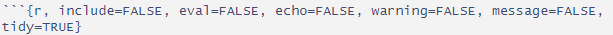
```

You can refer to the following table for their meanings:

```{r fig.pos='H',out.width='80%', echo=FALSE}
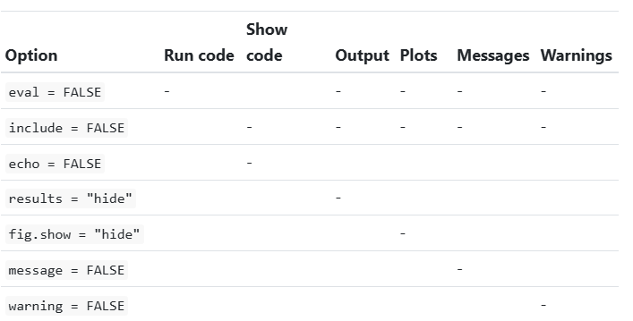
```

To run all the code within a chunk, you can click the button at the right up corner of the chunk:

```{r fig.pos='H',out.width='20%', echo=FALSE}

```

To run some selected code, you may use Ctrl+Enter:

```{r fig.pos='H',out.width='40%', echo=FALSE}
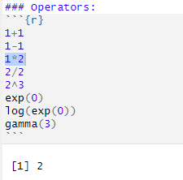
```

After finishing your assignments, knit it to a .pdf file and submit both the .rmd codes and the .pdf file through Moodle:

```{r fig.pos='H',out.width='25%', echo=FALSE}

```

### Getting Help
1. In Rstudio
2. chatgpt (strongly suggested)

```{r fig.pos='H',out.width='80%', echo=FALSE}
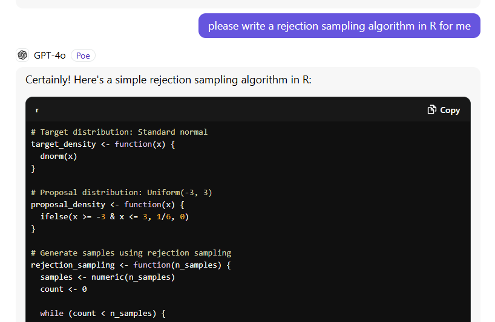
```

### Environment
To check what we have in hand

```{r fig.pos='H',out.width='80%', echo=FALSE}
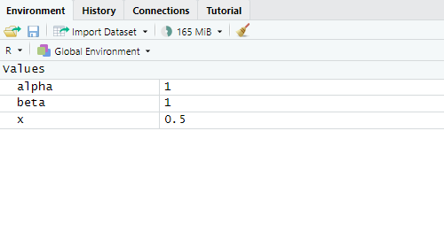
```

## R coding

Then, about the coding:

### Data structure:

The data structures that are useful in assignments: vector, matrix and data frame
```{r}
c(1,2,3,4)
c(1,2,3,4) %*% c(1,2,3,4)
matrix(c(1,2,3,4),nrow = 2,byrow = T)
matrix(c(1,2,3,4),nrow = 2,byrow = T) %*%
  solve(matrix(c(1,2,3,4),nrow = 2,byrow = T))
cbind(matrix(c(1,2,3,4),nrow = 2,byrow = T),matrix(c(1,2,3,4),nrow = 2,byrow = T))
rbind(matrix(c(1,2,3,4),nrow = 2,byrow = T),matrix(c(1,2,3,4),nrow = 2,byrow = T))
matrix(c(1,2,3,4),nrow = 2,byrow = T)[1,1:2]
df = data.frame(x = c(1,2,3,4), y=c(1,2,3,4))
mean(df$x)
df2 = readxl::read_xlsx("example.xlsx")
write.csv(df2, "example.csv")
df2 = read.csv("example.csv")
writexl::write_xlsx(df2,"example.xlsx")
```

### Operators:
```{r}
1+1
1-1
1*2
2/2
2^3
exp(0)
log(exp(0))
factorial(4)
gamma(3)
for (i in 1:4){
  if (i<2){
    print(i)}
}
```

For example, the Beta($\alpha, \beta$) likelihood is $\frac{\Gamma(\alpha+\beta)}{\Gamma(\alpha) \Gamma(\beta)} x^{\alpha-1} (1-x)^{\beta-1}$, suppose $x=0.5$, then we may calculate it by:

```{r}
alpha_ = 1
beta_ = 3
x_ = 0.5
beta_density = function(x, alpha, beta){
  return((gamma(alpha+beta)/ (gamma(alpha) * gamma(beta))) *
           (x^(alpha-1)) * (1-x)^(beta-1))
}
beta_density(x_, alpha_, beta_)
```

### Useful package 

For visualization, we recommend the package tidyverse, which is extremely useful in statistical analysis:

```{r}
#install.packages("tidyverse")
```
The package tidyverse is a strong tool for data cleaning, data analysis, and data visualization. So far we only focus on the visualization part, details can be found at https://ggplot2.tidyverse.org/

### Load the package:

```{r}
library(tidyverse)
```

### Density visualization

We can visualize the density as:
```{r}
X = seq(from=0, to=1, by=0.01)
Y = beta_density(X, alpha_, beta_)
ggplot(mapping = aes(x=X, y=Y)) + geom_line()
```

### Other useful functions

For commonly encountered distributions, there are some useful functions, take still the beta distribution as an example:

```{r}
dbeta(x_, shape1=alpha_, shape2=beta_) #probability densiy
pbeta(0.5, shape1=alpha_, shape2=beta_) #cumulative density
qbeta(0.875, shape1=alpha_, shape2=beta_) #quantile
rbeta(10, shape1 = alpha_, shape2=beta_) #generate a random sample
```

## LaTeX

A useful language for typing math formulas. You can refer to the Mathematics section of the Overleaf documentation at https://www.overleaf.com/learn/latex/Mathematical_expressions for a detailed introduction.

## How our professor prepares his slides:
For this section. if we don't have enough time in tutorial to cover, you may check with the lecture notes and run them by yourself, to have a better understanding of the lecture.

### Monte Carlo Method:

```{r fig.pos='H',out.width='80%', echo=FALSE}

```

In the following example, we use the Monte Carlo method to calculate an integral $\int_0^1 (\cos(50x) +sin(20x))^2 dx$ from 0 to 1, where the samples are taken from a Uniform(0,1) distribution.

```{r}
# monteCarloMethod.R
# This code uses Monte Carlo method to compute the
# integration of f(x) from 0 to 1
#######################################################
rm(list=ls())   #to remove all the things in the environment
set.seed(1234)
a <- 0; b <- 1
nsim <- 10000000; u <- runif(nsim, a, b)

#The function to be integrated
mci.ex <- function(x)
  (cos(50*x)+sin(20*x))^2

plot(function(x)mci.ex(x), xlim=c(0,1),ylim=c(0,4))

#The monte carlo sum

nsim <- 10000000; u <- runif(nsim, a, b)
sum(mci.ex(u))/nsim
```

```{r fig.pos='H',out.width='80%', echo=FALSE}
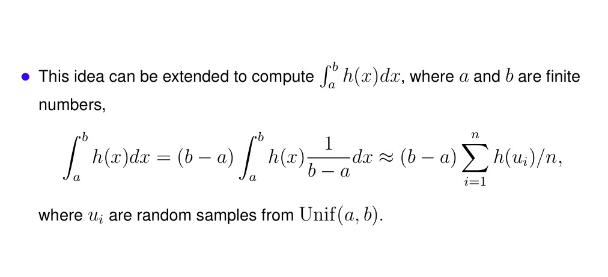
```

In the following example, the application of the Monte Carlo method has been extended, where the lower and upper bound can be any finite numbers $a,b$. We approximate the integral $\int_1^4 \sin x dx$.

```{r}
# Another example: uses Monte Carlo method to compute the
# integration of f(x) from a to b (a, b can be any finite numbers)
##################################################################
rm(list=ls())
set.seed(1234)
a <- 1; b <- 4
nsim <- 1000000; u <- runif(nsim, a, b)

#The function to be integrated
mci.ex <- function(x) sin(x)
  
-(cos(b)-cos(a)) # 1.193946

plot(function(x) mci.ex(x), xlim=c(a,b),ylim=c(0,1))

#The monte carlo sum
(b-a)*sum(mci.ex(u))/nsim
```

### Gamma to Beta

```{r fig.pos='H',out.width='80%', echo=FALSE}
knitr::include_graphics("pictures/Gtb.png")
```

To generate a random variable from $Beta(\alpha, \beta)$, we can generate $x \sim Gamma(\alpha,1)$ and $y \sim Gamma(\beta,1)$, then $\frac{x}{x+y}$ follows our target Beta distribution.

```{r}
# gammaToBeta.R
# Simulate x from Gamma(alpha,1) and y from Gamma(beta,1)
# Then x/(x+y) has Beta(alpha, beta) distribution
################################################################
rm(list=ls())
nSamples <- 5000000
alpha <- 2; beta <- 3

set.seed(1234)
x <- rgamma(nSamples, shape=alpha, rate=1)
y <- rgamma(nSamples, shape=beta, rate=1)

z <- x/(x+y)

z.den <- density(z)

plot(z.den$x, z.den$y, type="l", col="red")
points(z.den$x, dbeta(z.den$x,alpha,beta), type="l", col="blue")
legend(0.7, 1.5, legend=c("transformation","beta"),
       lty=c(1,1), col=c("red","blue"))

mean(z); var(z)

alpha/(alpha+beta)

```

### Rejection Sampling

```{r fig.pos='H',out.width='80%', echo=FALSE}
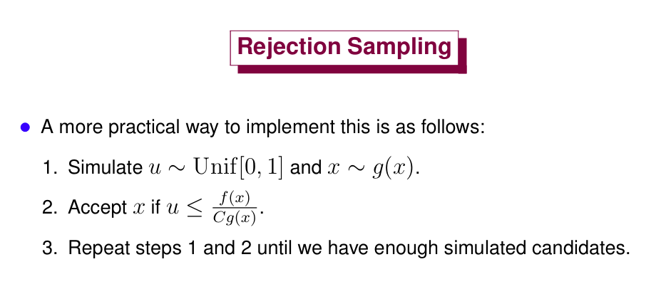
```

In this example, the target distribution is $N(1,4)$ and the proposal distribution is $Student-t(2)$ distribution.

```{r}
# rejectionSampling.R
# In this example, I use rejection sampling methods to obtain samples for N(1,4) from
# t(df=2)
##########################################################################################
rm(list=ls())
set.seed(1234)

nsub <- 1000
myDf <- 2; myMean <- 1; mySd <- 2
x1 <- rnorm(nsub, mean = myMean, sd = mySd)
max(dnorm(x1, mean=myMean, sd=mySd)/dt(x1, df=2))
C <- 5

x1.den <- density(x1)

# plot two density function f(x) and Cg(x)
plot(x1.den$x, dt(x1.den$x,df=myDf)*C, xlim=c(-10,10), type="l", col="red",
     xlab="x", ylab="Density", main="Density function")
points(x1.den$x, dt(x1.den$x,df=myDf), type="l",col="magenta")
points(x1.den$x, x1.den$y, type="l", col="blue")
legend(5, 1.6, legend=c("c*t_2", "t_2", "N(1,4)"),
       lty=c(1,1,1), col=c("red","magenta","blue"))

# check if all C*t_2 points are smaller than target density
table(dnorm(x1.den$x, mean=myMean, sd=mySd)<=dt(x1.den$x,df=myDf)*C)


# rejection sampling starts from here
C <- 5
nsim <- 100000
samples.g <- rt(nsim, df=myDf)
accept <- runif(nsim) <= (dnorm(samples.g, mean=myMean, sd=mySd)
                          /(C*dt(samples.g,df=myDf)))
table(accept)/nsim

mySamples <- samples.g[accept]
summary(mySamples)
mySamples.den <- density(mySamples)

# compare the density functions of the obtained samples and R samples
plot(mySamples.den, col="red", xlab="x", main="Density function")
points(mySamples.den$x, dnorm(mySamples.den$x, mean=myMean, sd=mySd), type="l", col="blue")
legend(5, 0.16, legend=c("samples", "N(1,4)"), lty=c(1,1), col=c("red","blue"))


# Q-Q plot raw vs simulated densities
qqplot(mySamples, x1, pch=20)
abline(0, 1)
```

```{r fig.pos='H',out.width='80%', echo=FALSE}
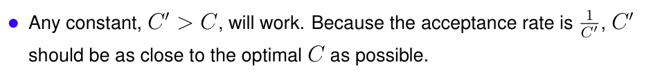
```

In the following example, we show that the constant $C$ used can be larger than the optimum one. 

```{r}
# 1. Define a density of interest that will be approximated by "REJECTION SAMPLING"
rm(list=ls())
knownDensity <- function(x) {
  return(dbeta(x, 3, 10))
}

sampleSize <- 3000
rawDensity <- rbeta(sampleSize, 3, 10)
rawDensity.den <- density(rawDensity)

rawDensity.x <- rawDensity.den$x[rawDensity.den$x >=0]
rawDensity.y <- rawDensity.den$y[rawDensity.den$x >=0]

C <- 40

# plot two density function f(x) and Cg(x)
plot(rawDensity.x, dunif(rawDensity.x)*C, xlim=c(0,1), type="l", col="red",
     xlab="x", ylab="Density", main="Density function")
points(rawDensity.x, rawDensity.y, type="l", col="blue")
legend(5, 1.6, legend=c("c*t_2", "target"),
       lty=c(1,1), col=c("red","blue"))


# 2. Rejection sampling method
xMin <- 0; xMax <- 1
mySequence <- seq(from=xMin, to=xMax, by=0.01)
max(knownDensity(mySequence))

C <- 40


nsim <- 10000000
samples.g <- runif(nsim)
u <- runif(nsim)
accept <- u <= (knownDensity(samples.g)/(C*1))
table(accept)/nsim

mySamples <- samples.g[accept]
summary(mySamples)
mySamples.den <- density(mySamples)

# plots of raw vs simulated density function
plot(mySamples.den, col="red", xlim=c(0,1), xlab="x", main="Density function")
points(mySamples.den$x, knownDensity(mySamples.den$x), type="l", col="blue")
legend(0.6, 3, legend=c("samples", "known"), lty=c(1,1), col=c("red","blue"))


# Q-Q plot raw vs simulated densities
qqplot(mySamples, rawDensity, pch=20)
abline(0, 1)

```

```{r fig.pos='H',out.width='80%', echo=FALSE}
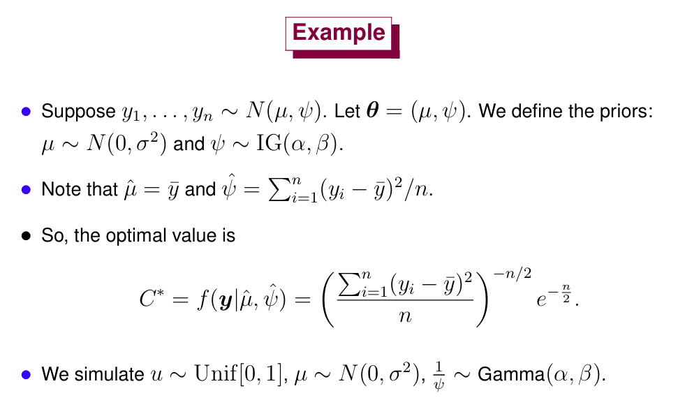
```

```{r fig.pos='H',out.width='80%', echo=FALSE}
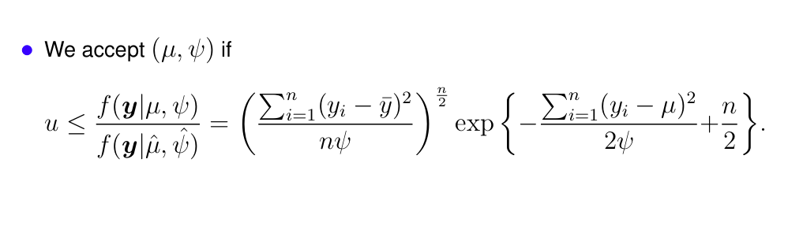
```

In this example, the target distribution is the posterior while the proposal distribution is the prior, where the rejection probability is proportional to the likelihood.

```{r}
# Example of rejection sampling from class
rm(list=ls())
set.seed(1234)
myMu <- 1; mySigma2 <- 4
n <- 150
y <- rnorm(n, mean=myMu, sd=sqrt(mySigma2))
ybar <- mean(y)
c(mean(y), var(y))

C.star <- (sum((y-ybar)^2)/n)^(-n/2)*exp(-n/2)

sim <- 1000000

#sigma <- 1; alpha <- 2; beta <- 1
sigma <- 10; alpha <- 0.01; beta <- 0.01
# simulate some candidates
mu <- rnorm(sim, mean = 0, sd = sigma)
psi <- 1 / rgamma(sim, shape=alpha, rate=beta)

# The acceptance probabilities on the log scale
log.fbycg <- (0.5*n*log(sum((y-ybar)^2)/n/psi)
              - (sum(y^2)-2*sum(y)*mu+n*mu^2)/2/psi + n/2)
str(log.fbycg)

# a boolean vector, TRUE at the indices where we accepted
accept <- log(runif(sim)) <= log.fbycg
table(accept)/sim

# the acceptance probability
mean(accept)

# the accepted mu's and psi's
mu <- mu[accept]
psi <- psi[accept]

c(mean(mu), mean(psi))

# plot the histograms and density estimates
#postscript("./plots/rejectionSampling_posterior.eps", paper="letter", horizontal=T)
#par(mfrow=c(2,2))
 # hist(mu)
  #plot(density(mu))
  #hist(psi)
  #plot(density(psi))
#dev.off()

df = data.frame(rbind(cbind(density(mu)$x, density(mu)$y, rep("mu",length(density(mu)$x))),
           cbind(density(psi)$x, density(psi)$y, rep("psi",length(density(psi)$x)))))
names(df) = c("x", "density", "parameter")
df$x = as.numeric(df$x)
df$density = as.numeric(df$density)
ggplot(data=df)+geom_line(mapping = aes(x, density))+ facet_wrap(~ parameter, nrow = 1)

# equi-tail Bayesian confidence intervals
quantile(mu, c(.025,.975))
quantile(psi, c(.025,.975))

# posterior mean
mean(mu)
```

### Importance Sampling

```{r fig.pos='H',out.width='80%', echo=FALSE}
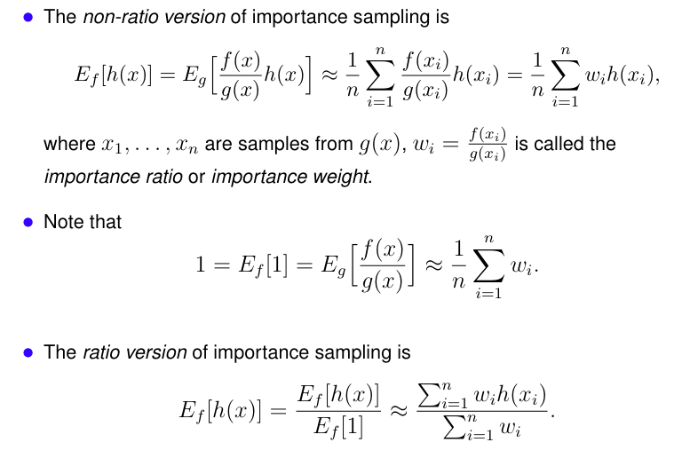
```

This example demonstrates how to computes the mean and variance of $Gamma(3,2/3)$ (target distribution) from $Exponential(1)$ (proposal distribution) using both the ratio and non-ratio versions of importance sampling method.

```{r}
# ImpSamp_gamma.R
# Compute the mean and variance of Gamma(3,2/3) from Exponential(1)
# True values: mean=2, var=1.33
###################################################################

#target = Gamma(2,2/3), candidate = exponential
rm(list=ls())
nsim <- 10000
target <- function(x)((27/16)*(x^2)*exp(-3*x/2))
candidate <- function(x)(exp(-x))

plot(function(x)target(x),xlim=c(0,10), col="red")
legend(6,0.35, legend=c("target","candidate"),lty=c(1,1),col=c("red","blue"))
par(new=T)
plot(function(x)candidate(x),xlab="",ylab="",xaxt="n",yaxt="n",col="blue")


#Compute the mean and variance using Importance Sampling in non-ratio version
y <- rexp(nsim)
m1 <- sum(y*target(y)/candidate(y))/nsim
m2 <- sum((y^2)*target(y)/candidate(y))/nsim
m1;  m2-m1^2


#Compute the mean and variance using Importance Sampling in ratio version
m1 <- sum(y*target(y)/candidate(y))/sum(target(y)/candidate(y))
m2 <- sum((y^2)*target(y)/candidate(y))/sum(target(y)/candidate(y))
m1;  m2-m1^2
```

```{r fig.pos='H',out.width='80%', echo=FALSE}
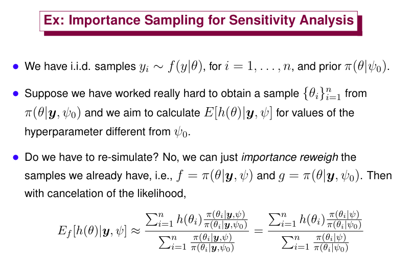
```

The $100$ observations $y_i$ are actually $i.i.d.$ from $\mathcal{N}(1,2)$. Well. let's pretend that we don't know this thing, we only know that $y_i$ from certain $\mathcal{N}(\mu, \sigma^2)$ distribution, and we are interested in $\mu$ now. We put a $\mathcal{N}(\alpha, \beta)$ prior over $\mu$. Our proposal distribution is hence the posterior distribution under the condition $\alpha = -5$, while our target is the posterior distribution under the condition $\alpha = 5$.


```{r}
# ImpSamp_sensitivity.R
# Using importance sampling for sensitivity analysis
#################################################################

rm(list=ls())

# myMu, sigma: parameters for the data y_i
myMu <- 1; sigma <- 2
# n: number of observations
n <- 100  
# beta: variance of the prior distribution of the mean of y_i
beta <- 1000000

set.seed(1234)
# y: observations
y <- rnorm(n, mean=myMu, sd=sqrt(sigma))
ybar <- mean(y)

# alpha0, alpha1: hyperparameters
alpha0 <- -5; alpha1 <- 5

# the posterior mean
cal.mean <- function(alpha, beta) {
  (ybar*beta+alpha*sigma/n)/(beta+sigma/n)
}

# the posterior variance
cal.var <- function(beta) {
  (beta*sigma/n)/(beta+sigma/n)
}

# nSamples: number of samples from posterior distribution of \mu
#           with hyperparameters \alpha_0 and \beta
nSamples <- 1000000
# mySamples: samples from posterior distribution of \mu
#           with hyperparameters \alpha_0 and \beta
mySamples <- rnorm(nSamples, mean=cal.mean(alpha0,beta),
                   sd=sqrt(cal.var(beta)))
summary(mySamples)

# den.new: the density function of the samples
#          under the hyper-parameters \alpha_1 and \beta
den.new <- dnorm(mySamples, mean=cal.mean(alpha1,beta),
                 sd=sqrt(cal.var(beta)))
# den.old: the density function of the samples
#          under the hyper-parameters \alpha_0 and \beta
den.old <- dnorm(mySamples, mean=cal.mean(alpha0,beta),
                 sd=sqrt(cal.var(beta)))

h <- function(x) x^2

# importance sampling
sum(h(mySamples)*den.new/den.old)/sum(den.new/den.old)

sum(h(mySamples)*den.new/den.old)/nSamples

# true values
true.value <- cal.var(beta) + (cal.mean(alpha1,beta))^2
true.value
```

```{r fig.pos='H',out.width='80%', echo=FALSE}
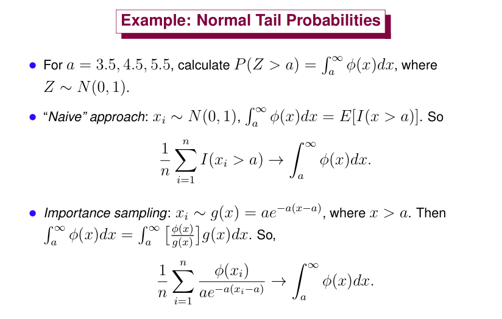
```

```{r fig.pos='H',out.width='80%', echo=FALSE}
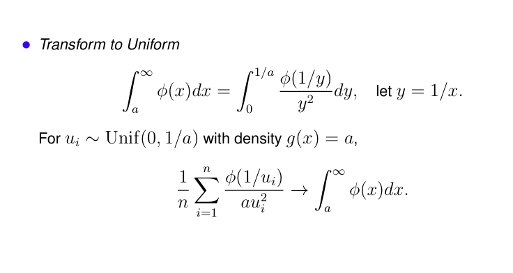
```

```{r}
#This gives an importance sampling algorithm for a Truncated Normal#
a <- 3.5			 		#Truncation Point
n <- 500000				#Sample size
#---------Note!!  R can do this with 1-pnorm(3.5) and 1-pnorm(4.5)
1-pnorm(a)

#---------Generate a Sample Naively-------------------------
#---------Take n=50000, a=3.5 and 4.5--------------------------
X <- rnorm(n)
table(X>a)
mean((X>a))

#----------Use Accept Reject--------------------------------
nsim <- 1000				#much smaller sample
X <- rexp(nsim,a)+a
mean(dnorm(X)/(a*exp(-a*(X-a))))
#sd(dnorm(X)/(a*exp(-a*(X-a))))


#-----------Use Uniform----------------------------------
U <- runif(nsim,0,1/a)
mean(dnorm(1/U)/(a*U^2))
#sd(dnorm(1/U)/(a*U^2))
```

